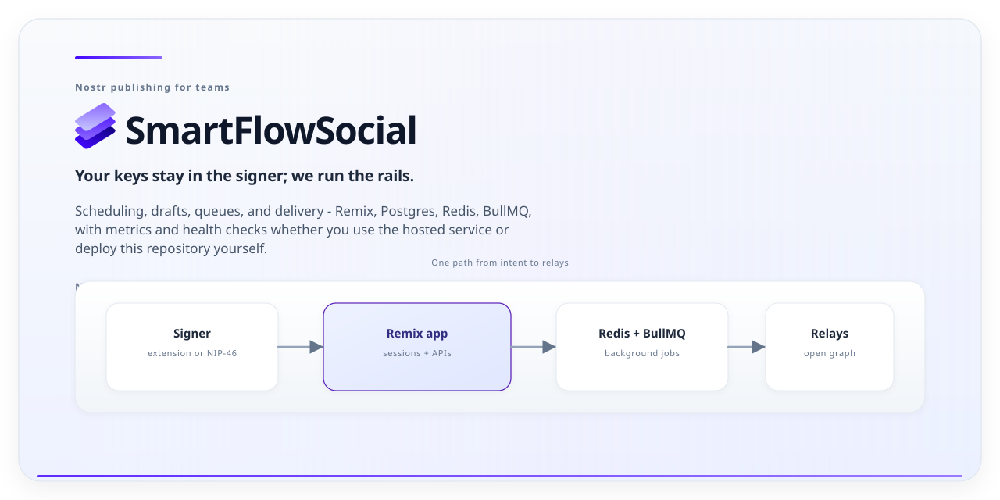

# SmartFlowSocial

Professional Nostr social media management for creators, teams, and communities.



[](https://github.com/xdzczk/SmartFlowSocial/actions/workflows/ci.yml)
[](https://github.com/xdzczk/SmartFlowSocial/releases)
[](https://nodejs.org/)
[](https://pnpm.io/)
[](https://remix.run/)
[](https://www.postgresql.org/)
[](https://redis.io/)
[](LICENSE)

[Start on Hosted](https://smartflow.social) • [Hosted Setup Guide](./docs/getting-started/hosted.md)
• [Self-Host Guide](./docs/getting-started/quickstart.md) • [Documentation](./docs/README.md)

---

Nostr teams usually juggle three pressures at once: **fast product UX**, **reliable scheduling and
media**, and **signing that stays under the user’s control**. SmartFlowSocial is built for that
intersection - a full publishing and engagement surface where browser extension (NIP-07) or remote
signer (NIP-46) flows stay first-class, while drafts, queues, calendars, and background jobs keep
day-to-day operations predictable.

The design goal is straightforward: **treat the open protocol as the source of truth for what gets
published**, while the application owns durable workflow state, observability, and the boring
operational glue (storage, retries, metrics) that creators still need to ship consistently.

You can adopt it as the **hosted service** at [smartflow.social](https://smartflow.social) for the
fastest path, or run the **same codebase** yourself when you need data residency, custom
integrations, or hard cost controls. Feature depth is tracked in the
[Feature Coverage Matrix](./docs/reference/feature-coverage-matrix.md).

---

## At a glance

| Area                         | Value                                                                          |
| ---------------------------- | ------------------------------------------------------------------------------ |
| Default web (local dev)      | `http://localhost:3000`                                                        |
| Prometheus metrics (default) | `http://localhost:3010/metrics` (see `METRICS_PORT`)                           |
| `pnpm docker`                | PostgreSQL on host port **5433** → container `5432`, Redis on **6379**         |
| `pnpm dev`                   | Remix dev server, Node HTTP server, and **worker** (esbuild watch) in parallel |
| Node runtime                 | `20+`                                                                          |
| Package manager              | `pnpm@10.27.0` (repo pin in `package.json` → `packageManager`)                 |
| Database                     | PostgreSQL + Prisma                                                            |
| Queue / cache                | Redis + BullMQ                                                                 |
| Asset storage                | S3-compatible object storage                                                   |
| Nostr signing                | NIP-07 browser extensions, NIP-46 remote signers                               |
| Deploy options               | Hosted service or self-hosted deployment                                       |

Configuration reference: [Configuration](./docs/reference/configuration.md)

---

## Start here

| If you are…                 | Start here                                                   | Then read                                                    |
| --------------------------- | ------------------------------------------------------------ | ------------------------------------------------------------ |
| New to the product (hosted) | [Hosted quick start](./docs/getting-started/hosted.md)       | [Posting guide](./docs/guides/user-guides/posting.md)        |
| Self-hosting locally        | [5-minute quick start](./docs/getting-started/quickstart.md) | [Installation](./docs/getting-started/installation.md)       |
| Deploying to production     | [Deployment guide](./docs/guides/deployment.md)              | [Operations](./docs/guides/operations.md)                    |
| Operating the stack         | [Operations guide](./docs/guides/operations.md)              | [Configuration reference](./docs/reference/configuration.md) |
| Integrating with APIs       | [API reference](./docs/reference/api.md)                     | [API development](./docs/guides/api-development.md)          |
| Building or contributing    | [CONTRIBUTING.md](./CONTRIBUTING.md)                         | [Testing guide](./docs/guides/testing.md)                    |
| Reporting security issues   | [SECURITY.md](./SECURITY.md)                                 | [Security guide](./docs/guides/security.md)                  |

Complete docs index: [docs/README.md](./docs/README.md)

---

## Hosted (recommended)

1. Open [smartflow.social](https://smartflow.social)
2. Sign in with a NIP-07 extension (Alby / nos2x / Amber) or a NIP-46 remote signer
3. Create and schedule your first post

Next: [Calendar guide](./docs/guides/user-guides/calendar.md) •
[Engagement guide](./docs/guides/user-guides/engagement.md)

---

## Verify in 60 seconds

After `pnpm dev` is running, use this sequence:

1. **Process health** (deterministic on a healthy boot):

```bash
curl -i http://localhost:3000/healthcheck
curl -I http://localhost:3000
```

2. **Metrics** (deterministic when the worker process is up and `METRICS_PORT` is default):

```bash
curl http://localhost:3010/metrics
```

Expected:

- `/healthcheck` returns `200 OK`
- Root URL returns an HTTP success or redirect response
- `/metrics` returns Prometheus-formatted text

Operational details: [Operations guide](./docs/guides/operations.md)

---

## Self-hosted quick start

Prerequisites: Node.js 20+, pnpm, PostgreSQL, Redis, S3-compatible storage.

```bash
git clone https://github.com/xdzczk/SmartFlowSocial.git
cd SmartFlowSocial
pnpm install
cp example.env .env
pnpm docker
pnpm exec prisma generate
pnpm exec prisma db push
pnpm db:seed
pnpm dev
```

Then open `http://localhost:3000`.

**What `pnpm docker` starts:** only `postgres` and `redis` from
[`docker-compose.yml`](./docker-compose.yml). Point `DATABASE_URL` at Postgres (for the default
compose file, the host port is **5433**) and `REDIS_URL` at Redis before running migrations or the
app.

**What `pnpm dev` starts:** the Remix dev surface, the Node HTTP server bundle, and the worker
bundle (see `package.json` scripts `dev:*`).

**Runtime notes:** copy [`example.env`](./example.env) to `.env` and fill storage, session, and
Nostr-related variables for the paths you exercise; optional services (Sentry, Primal caching URLs,
Lightning) are documented in [Configuration](./docs/reference/configuration.md).

Further reading: [Self-host quickstart](./docs/getting-started/quickstart.md) •
[Installation](./docs/getting-started/installation.md) • [Deployment](./docs/guides/deployment.md)

---

## Core capabilities

### Publishing and planning

- Instant and scheduled posting
- Queue-based and interval scheduling
- Calendar-based planning
- Drafts, templates, and recyclable content
- Long-form article support (NIP-23)

### Engagement and growth

- Engagement feed and triage workflows
- Signed DM broadcast campaigns
- Giveaways and contests with payout tracking
- Multi-account parent/child management

### APIs and automation

- REST APIs for publishing, queue management, media uploads, and engagement workflows
- Session-based authentication for app and API usage
- Admin and telemetry endpoints for operations insight

Full endpoint inventory: [API reference](./docs/reference/api.md)

---

## Architecture at a glance

- Full-stack app built with [Remix](https://remix.run) and TypeScript
- PostgreSQL + Prisma for durable relational data
- Redis + BullMQ for background jobs and queue orchestration
- Tailwind + shadcn/ui for product interface layer
- Lightning-native payment integrations (NWC and BTCPay configuration support)
- Nostr protocol integration and signer workflows (NIP-07 and NIP-46)

Deep dive: [Architecture documentation](./docs/getting-started/architecture.md)

---

## Toolchain policy

- **Minimum Node.js:** `20` (see badge row and CI workflows under `.github/workflows/`)
- **Package manager:** install pnpm via Corepack or your preferred method; the repository pins
  **`pnpm@10.27.0`** in `package.json` (`packageManager`) so installs stay reproducible across
  machines and CI.

---

## Repository layout

- `app/` - Remix routes, features, UI, and server modules
- `prisma/` - schema, migrations, and seed entrypoints
- `docs/` - user guides, reference, tutorials, and operations material
- `tests/` - unit, integration, E2E (Cypress), security, and performance suites
- `scripts/` - build, maintenance, and developer automation helpers
- `public/` - static assets and PWA/OG imagery

---

## Operations and security

- Health, metrics, and reliability runbooks: [Operations guide](./docs/guides/operations.md)
- Deployment patterns and hardening guidance: [Deployment guide](./docs/guides/deployment.md)
- Security model and reporting guidance: [Security guide](./docs/guides/security.md)
- Data and privacy model overview: [Threat model](./docs/reference/threat-model.md)

---

## Quality gates for contributors

```bash
pnpm lint
pnpm typecheck
pnpm test
```

Additional test suites (integration, E2E, security, performance) are documented in
[Testing guide](./docs/guides/testing.md).

Contribution workflow: [CONTRIBUTING.md](./CONTRIBUTING.md)

---

## Current scope and known limitations

- The project supports both hosted and self-hosted usage, but production operations still require
  explicit environment and observability setup.
- E2E coverage is being modernized toward flow-oriented suites; see
  [Legacy migration map](./tests/e2e/LEGACY_MIGRATION_MAP.md).
- Feature and API documentation coverage is tracked separately from behavioral guarantees; see
  [Feature coverage matrix](./docs/reference/feature-coverage-matrix.md).

Roadmap and changes: [CHANGELOG](./CHANGELOG.md)

---

## Community and support

- Hosted: [smartflow.social](https://smartflow.social)
- Docs hub: [docs/README.md](./docs/README.md)
- Bug reports and feature requests:
  [GitHub Issues](https://github.com/xdzczk/SmartFlowSocial/issues)
- Questions and ideas: [GitHub Discussions](https://github.com/xdzczk/SmartFlowSocial/discussions)

---

## License

[Unlicense](./LICENSE) (public domain).

---

## Project policy references

- [CONTRIBUTING.md](./CONTRIBUTING.md)
- [SECURITY.md](./SECURITY.md)
- [CODE_OF_CONDUCT.md](./CODE_OF_CONDUCT.md)
- [CHANGELOG.md](./CHANGELOG.md)
