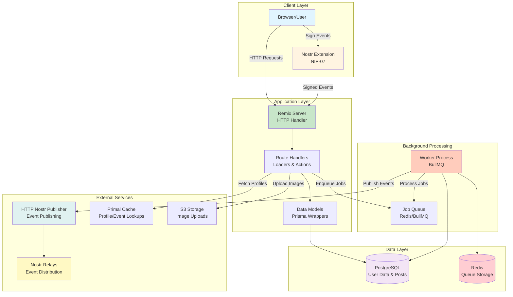

# SmartFlowSocial

<div align="center">

[](https://remix.run/)
[](https://nostr.com/)
[](https://opensource.org/licenses/MIT)
[](./CHANGELOG.md)
[](https://www.postgresql.org/)
[](https://www.typescriptlang.org/)
[](./docs/guides/testing.md#coverage)
[](https://nodejs.org/)

**Professional-grade social media management platform for Nostr. Schedule, manage, and optimize your decentralized social presence.**

[Features](#-features) • [Quick Start](#-quick-start) • [API](./docs/reference/api.md) • [Documentation](./docs/README.md) • [Contributing](./CONTRIBUTING.md)

</div>

---

## 🌐 Get Started

**Choose your path:**

- 🚀 **[Try Hosted Version](https://smartflow.social)** - No setup required, start in seconds
- 🏠 **[Self-Host](#-quick-start)** - Full control, free forever
- 🔓 **[Contribute](./CONTRIBUTING.md)** - Open source, MIT licensed

**New to SmartFlowSocial?** Start with our [hosted instance](https://smartflow.social) to explore features, then self-host if you want full control over your data and infrastructure.

> 💡 **Note**: SmartFlowSocial is also available at [smartflowsocial.com](https://smartflowsocial.com)

---

## 🎯 What is SmartFlowSocial?

SmartFlowSocial is a **self-hosted, professional-grade social media management platform** for the Nostr protocol. It empowers creators, businesses, and communities to manage their decentralized social presence with enterprise-level features.

### Why SmartFlowSocial?

- 🔐 **Privacy-First**: Your keys, your data, your control. We never see your private keys.
- 🚀 **Professional Features**: Scheduling, queues, analytics, and more
- 🏠 **Self-Hosted**: Own your infrastructure and data
- ⚡ **Lightning-Native**: Built for the Bitcoin/Lightning ecosystem
- 🎨 **Beautiful UI**: Modern, intuitive interface
- 🔧 **Developer-Friendly**: TypeScript, [REST API](./docs/reference/api.md), well-documented, extensible

### Who is it for?

- **Content Creators**: Schedule posts, manage multiple accounts, track engagement
- **Businesses**: Professional social media management for Nostr
- **Communities**: Manage community accounts and engagement
- **Developers**: Self-hosted alternative with [full REST API](./docs/reference/api.md) for automation and integrations
- **Bitcoiners**: Native Lightning payments and Nostr integration
- **Privacy-Conscious Users**: Self-host for complete data control, or use our hosted instance with client-side signing

---

## ✨ Features

### 📝 Post Management

- **Instant Posting** — Post to Nostr with one click
- **Scheduled Posts** — Plan content days, weeks, or months in advance
- **Bulk Upload** — Upload multiple images with auto-scheduled intervals
- **Recyclable Posts** — Reuse evergreen content efficiently
- **Long-form Articles** — Full NIP-23 article support with rich text editor
- **Drafts** — Save work-in-progress posts
- **Templates** — Reusable post structures

### 📅 Scheduling & Queues

- **Calendar View** — Visual drag-and-drop scheduling (weekly/monthly views)
- **Multiple Queues** — Organize content with different scheduling rules
- **Interval Scheduling** — Post every X hours automatically
- **Fixed Time Slots** — Post at specific times daily
- **Queue Override** — Manual scheduling with smart queue integration

### 🎁 Engagement & Tools

- **Engagement Feed** — Track replies, mentions, and interactions
- **Nostr Giveaways** — Create native giveaways with fair winner selection
- **Blacklist Management** — Block bots and spam accounts
- **Hashtag Presets** — Reusable hashtag collections
- **Multi-Account** — Parent/child account relationships

### 💰 Payments & Subscriptions

- **Lightning Payments** — Subscription payments via NWC (Nostr Wallet Connect)
- **Multiple Plans** — Free, Basic, Premium, Pro, Enterprise
- **Feature Gating** — Plan-based feature access
- **Self-Hosted** — No vendor lock-in

### 🖼️ Media & Storage

- **S3-Compatible Storage** — Upload images to S3, Cloudflare R2, MinIO, etc.
- **Blossom Support** — Optional Blossom protocol integration
- **Multiple Providers** — Choose your preferred upload provider
- **Image Optimization** — Automatic optimization and thumbnails

### 🔌 API & Integrations

- **REST API** — Full programmatic access to all features
- **Session Authentication** — Cookie-based authentication
- **File Upload API** — Upload media programmatically
- **Queue Management** — Schedule and manage posts via API
- **Webhook Support** — Integrate with external services

**Quick API Example:**
```typescript
// Publish a post via API
const response = await fetch('https://your-domain.com/api/publish', {
  method: 'POST',
  headers: { 'Content-Type': 'application/json' },
  credentials: 'include', // Includes session cookie for authentication
  body: JSON.stringify({
    signedEvent: nostrEvent, // Signed with NIP-07 extension
    postId: 'post-123'
  })
});

const result = await response.json();
// { success: true, data: { ... } }
```

**Available Endpoints:**
- `POST /api/publish` - Publish posts to Nostr
- `POST /api/upload` - Upload images/files
- `POST /api/queue-schedule` - Get queue schedule times
- `POST /api/effective-hashtags` - Get hashtags for queue
- `GET /api/error-metrics` - Get error statistics
- And more...

📖 **[Full API Reference](./docs/reference/api.md)** — Complete API documentation with authentication, all endpoints, request/response examples, and error handling

---

## 🚀 Quick Start

### Prerequisites

- **Node.js** 20.0.0 or higher
- **pnpm** (install with: `npm install -g pnpm`)
- **PostgreSQL** database
- **Redis** (for queue processing)
- **Nostr Browser Extension** (Alby, nos2x, or Amber)

### 5-Minute Setup

```bash
# 1. Clone the repository
git clone https://github.com/xdzczk/SmartFlowSocial.git
cd SmartFlowSocial

# 2. Install dependencies
pnpm install

# 3. Set up environment
cp example.env .env
# Edit .env with your configuration

# 4. Start services (Docker)
pnpm docker  # Starts PostgreSQL and Redis

# 5. Set up database
pnpm exec prisma generate
pnpm exec prisma db push
pnpm db:seed

# 6. Start development server
pnpm dev
```

**That's it!** Open [http://localhost:3000](http://localhost:3000) and start managing your Nostr presence.

> 💡 **Tip**: See [Installation Guide](./docs/getting-started/installation.md) for detailed configuration, or [Deployment Guide](./docs/guides/deployment.md) for production deployment.

### Docker Quick Start (Alternative)

```bash
# Using Docker Compose
docker-compose up -d

# Configure environment
cp example.env .env
# Edit .env

# Run migrations
docker-compose exec app pnpm exec prisma migrate deploy

# Access at http://localhost:3000
```

---

## 🏗️ Architecture

### System Architecture Overview



### Key Components

- **Client Layer**: Browser with Nostr extension for client-side signing
- **Application Layer**: Remix server handling HTTP requests and business logic
- **Background Processing**: Worker process for scheduled post publishing
- **Data Layer**: PostgreSQL for persistent data, Redis for queue management
- **External Services**: Nostr Publisher, Primal Cache, S3 Storage, Nostr Relays

### Data Flow

1. **User Action** → Browser sends request to Remix server
2. **Authentication** → Server validates Nostr signature
3. **Business Logic** → Route handlers process request
4. **Data Access** → Models interact with PostgreSQL
5. **Job Scheduling** → Scheduled posts enqueued in Redis
6. **Background Processing** → Worker processes jobs and publishes to Nostr
7. **Event Distribution** → HTTP Publisher sends to Nostr relays

See [Architecture Documentation](./docs/getting-started/architecture.md) for detailed information.

---

## ⚙️ Tech Stack

| Layer | Technology | Why |
|-------|-----------|-----|
| **Framework** | [Remix](https://remix.run) | Full-stack React with excellent DX |
| **Database** | PostgreSQL + [Prisma](https://prisma.io) | Type-safe database access |
| **Styling** | [TailwindCSS](https://tailwindcss.com) | Rapid UI development |
| **UI Components** | [Headless UI](https://headlessui.com) + [Radix UI](https://radix-ui.com) | Accessible, unstyled components |
| **Queue System** | [BullMQ](https://docs.bullmq.io/) + Redis | Reliable background job processing |
| **Protocol** | [Nostr](https://nostr.com) | Decentralized social protocol |
| **Payments** | Lightning Network (NWC) | Native Bitcoin payments |
| **API** | REST API | Full programmatic access ([docs](./docs/reference/api.md)) |
| **Runtime** | Node.js >= 20.0.0 | Modern JavaScript runtime |

---

## 🆚 Comparison with Alternatives

SmartFlowSocial vs. other Nostr scheduling and management tools:

| Feature | SmartFlowSocial | [Primal Studio](https://studio.primal.net/) | [Shipyard](https://shipyard.pub/) |
|---------|----------------|--------------------------------------------|-----------------------------------|
| **Deployment** | ✅ Self-hosted (Open Source) | ❌ Cloud-hosted only | ❌ Cloud-hosted only |
| **Open Source** | ✅ MIT License | ❌ Proprietary | ❌ Proprietary |
| **Data Ownership** | ✅ Full control | ⚠️ Hosted by provider | ⚠️ Hosted by provider |
| **Pricing** | ✅ Free (self-hosted) + Optional paid plans | 💰 Paid subscription | 💰 Paid subscription |
| **Post Scheduling** | ✅ Advanced (queues, intervals, fixed slots | ✅ Basic scheduling | ✅ Basic scheduling |
| **Calendar View** | ✅ Drag-and-drop (weekly/monthly) | ❌ List view only | ❌ List view only |
| **Bulk Upload** | ✅ Multiple images with auto-scheduling | ❌ Not available | ❌ Not available |
| **Long-form Posts** | ✅ Full NIP-23 support | ⚠️ Limited | ⚠️ Limited |
| **Multiple Queues** | ✅ Advanced queue management | ❌ Single queue | ❌ Single queue |
| **Templates** | ✅ Reusable post templates | ❌ Not available | ❌ Not available |
| **Recyclable Posts** | ✅ Reuse evergreen content | ❌ Not available | ❌ Not available |
| **Engagement Feed** | ✅ Track replies, mentions | ⚠️ Basic | ⚠️ Basic |
| **Giveaways** | ✅ Native Nostr giveaways | ❌ Not available | ❌ Not available |
| **Multi-Account** | ✅ Parent/child accounts | ❌ Not available | ❌ Not available |
| **Lightning Payments** | ✅ Native NWC integration | ⚠️ Limited | ⚠️ Limited |
| **Storage Options** | ✅ S3, Blossom, multiple providers | ⚠️ Provider-specific | ⚠️ Provider-specific |
| **API Access** | ✅ [Full API available](./docs/reference/api.md) | ❌ Not available | ❌ Not available |
| **Customization** | ✅ Full code access | ❌ Limited | ❌ Limited |
| **Privacy** | ✅ Keys never leave browser | ⚠️ Depends on provider | ⚠️ Depends on provider |
| **Offline Support** | ✅ Self-hosted = always available | ⚠️ Requires internet | ⚠️ Requires internet |
| **Community** | ✅ Open source community | ⚠️ Limited | ⚠️ Limited |

### Key Differentiators

**SmartFlowSocial Advantages:**
- 🏠 **Self-Hosted**: Complete control over your data and infrastructure
- 🔓 **Open Source**: MIT licensed, fully auditable code
- 🚀 **Advanced Features**: Calendar view, bulk upload, queues, templates
- 🔐 **Privacy-First**: Client-side signing, keys never leave browser
- 💰 **Cost-Effective**: Free to self-host, optional paid features
- 🔧 **Extensible**: Full code access and [REST API](./docs/reference/api.md) for customization

**When to Choose SmartFlowSocial:**
- You want full control over your data
- You need advanced scheduling features
- You prefer self-hosting
- You want to customize/extend functionality with [API access](./docs/reference/api.md)
- You value privacy and data ownership
- You're comfortable with self-hosting
- You need to integrate with external services or automate workflows

**When to Consider Alternatives:**
- You prefer managed/hosted solutions
- You don't want to manage infrastructure
- You need simpler, basic scheduling only
- You prefer cloud-based convenience

---

## 📚 Documentation

### Quick Start
- **[5-Minute Quick Start](./docs/getting-started/quickstart.md)** - Get running fast
- **[Installation Guide](./docs/getting-started/installation.md)** - Complete setup
- **[First Steps](./docs/getting-started/first-steps.md)** - Your first 30 minutes

### Getting Started
- [Quick Start](./docs/getting-started/quickstart.md) - 5-minute setup
- [Installation](./docs/getting-started/installation.md) - Complete installation guide
- [First Steps](./docs/getting-started/first-steps.md) - Learn the basics
- [Core Concepts](./docs/getting-started/concepts.md) - Understand how it works
- [Architecture](./docs/getting-started/architecture.md) - System design

### User Guides
- [Posting Guide](./docs/guides/user-guides/posting.md) - Create and schedule posts
- [Calendar Guide](./docs/guides/user-guides/calendar.md) - Visual scheduling
- [Payments Guide](./docs/guides/user-guides/payments.md) - Subscription management

### Developer Guides
- [Developer Guide](./docs/guides/developer-guide.md) - Development workflow
- **[API Development](./docs/guides/api-development.md)** - Building API endpoints
- [Testing Guide](./docs/guides/testing.md) - Testing strategies
- [Contributing Guide](./CONTRIBUTING.md) - How to contribute

### Operations
- [Deployment Guide](./docs/guides/deployment.md) - Production deployment
- [Operations Guide](./docs/guides/operations.md) - Monitoring and maintenance
- [Security Guide](./docs/guides/security.md) - Security best practices

### Reference
- **[API Reference](./docs/reference/api.md)** - Complete API documentation with examples and authentication
- [Configuration](./docs/reference/configuration.md) - Environment variables
- [Database Schema](./docs/reference/database-schema.md) - Data models
- [Nostr Integration](./docs/reference/nostr.md) - Nostr protocol details
- [Performance](./docs/reference/performance.md) - Optimization strategies

### Troubleshooting
- [Common Issues](./docs/troubleshooting/common-issues.md) - Frequently asked questions
- [Error Solutions](./docs/troubleshooting/errors.md) - Error resolution

**📖 [Full Documentation Index](./docs/README.md)** - Complete documentation hub

---

## 🧪 Testing

SmartFlowSocial has comprehensive test coverage:

```bash
# Run all tests
pnpm test

# Run specific test suites
pnpm test:unit          # Unit tests
pnpm test:integration   # Integration tests
pnpm test:e2e          # End-to-end tests (Cypress)
pnpm test:property     # Property-based tests
pnpm test:security     # Security tests
pnpm test:performance  # Performance tests

# With coverage
pnpm test:coverage
```

**Coverage**: 70%+ with comprehensive test suites

See [Testing Guide](./docs/guides/testing.md) for detailed information.

---

## 📜 Available Scripts

| Script | Description |
|--------|-------------|
| `pnpm dev` | Start development server |
| `pnpm build` | Build for production |
| `pnpm start` | Start production server |
| `pnpm start:worker` | Start background worker |
| `pnpm lint` | Run ESLint |
| `pnpm format` | Format code with Prettier |
| `pnpm test` | Run all tests |
| `pnpm test:coverage` | Run tests with coverage |
| `pnpm db:seed` | Seed database |
| `pnpm docker` | Start PostgreSQL/Redis via Docker |
| `pnpm precheck` | Run lint, tests, and type check |

---

## 🌐 External Services

SmartFlowSocial integrates with several external services:

| Service | Purpose | Required | Setup Guide |
|---------|---------|----------|-------------|
| [HTTP Nostr Publisher](https://github.com/getAlby/http-nostr-publisher) | Signs and publishes Nostr events | ✅ Yes | [Deployment Guide](./docs/guides/deployment.md) |
| [Primal Caching Service](https://github.com/PrimalHQ/primal-caching-service) | Profile/event lookups | ⚠️ Optional | Uses public endpoints by default |
| Redis | Background job processing | ✅ Yes | [Operations Guide](./docs/guides/operations.md) |
| PostgreSQL | Database | ✅ Yes | [Installation Guide](./docs/getting-started/installation.md) |
| S3-Compatible Storage | Image uploads | ✅ Yes | [Installation Guide](./docs/getting-started/installation.md) |

---

## 🚢 Deployment

SmartFlowSocial can be deployed to various platforms:

### One-Click Deploy

[](https://fly.io/docs/getting-started/node/)
[](https://railway.app)
[](https://render.com)

### Manual Deployment

- **Fly.io**: [Deployment Guide](./docs/guides/deployment.md#flyio)
- **Railway**: [Deployment Guide](./docs/guides/deployment.md#railway)
- **Docker**: [Docker Deployment](./docs/guides/deployment.md#docker-deployment)
- **AWS/EC2**: [AWS Deployment](./docs/guides/deployment.md#aws-ec2ecs)
- **VPS**: [VPS Deployment](./docs/guides/deployment.md#vps-deployment)

See [Deployment Guide](./docs/guides/deployment.md) for detailed instructions.

---

## 🤝 Contributing

We welcome contributions! Here's how you can help:

1. **Fork the repository**
2. **Create a feature branch** (`git checkout -b feature/amazing-feature`)
3. **Make your changes**
4. **Run tests** (`pnpm test`)
5. **Commit your changes** (`git commit -m 'feat: add amazing feature'`)
6. **Push to the branch** (`git push origin feature/amazing-feature`)
7. **Open a Pull Request**

### Contribution Areas

- 🐛 **Bug Fixes**: Report and fix issues
- ✨ **Features**: Add new functionality
- 📚 **Documentation**: Improve docs
- 🧪 **Tests**: Increase test coverage
- 🎨 **UI/UX**: Improve user experience
- ⚡ **Performance**: Optimize code

See [Contributing Guide](./CONTRIBUTING.md) for detailed guidelines.

---

## 🛡️ Security

Security is a top priority:

- 🔐 **Client-Side Signing**: Private keys never leave your browser
- 🔒 **Server-Side Validation**: All inputs validated
- 🛡️ **Security Headers**: CSP, HSTS, and more
- 🔍 **Regular Audits**: Security testing included
- 📝 **Responsible Disclosure**: Report security issues privately

See [Security Guide](./docs/guides/security.md) for best practices and reporting.

---

## 📊 Project Status

- ✅ **Production Ready**: Stable and battle-tested
- ✅ **Active Development**: Regular updates and improvements
- ✅ **Well Tested**: 70%+ test coverage
- ✅ **Well Documented**: Comprehensive documentation
- ✅ **Community Driven**: Open to contributions
- ✅ **API Available**: Full REST API for automation and integrations

**Current Version**: v1.0.0 — See [CHANGELOG](./CHANGELOG.md) for latest changes and version history.

---

## ❓ FAQ

### Is SmartFlowSocial free?

Yes! SmartFlowSocial is open-source (MIT License) and free to use. The hosted version offers a free plan with basic features, and paid plans for advanced features. Self-hosting is completely free forever.

### Is there a hosted version?

Yes! We offer a hosted instance at [smartflow.social](https://smartflow.social) and [smartflowsocial.com](https://smartflowsocial.com). You can also [self-host](#-quick-start) for full control over your data and infrastructure.

### How do I sign up for the hosted version?

Visit [smartflow.social](https://smartflow.social) and sign up with your Nostr extension. No credit card required for the free plan.

### What's the difference between hosted and self-hosted?

- **Hosted**: Managed by us, no setup required, optional paid plans for advanced features
- **Self-Hosted**: Full control, free forever, requires technical setup

### Do I need to host it myself?

No! You can use our [hosted instance](https://smartflow.social) with no setup required. Alternatively, you can self-host for full control over your data and infrastructure.

### Is my data private?

Absolutely. Your private keys never leave your browser. All events are signed client-side using NIP-07. We never see or store your private keys.

### Can I use it with multiple Nostr accounts?

Yes! SmartFlowSocial supports parent/child account relationships, allowing you to manage multiple accounts from one interface.

### What Nostr extensions are supported?

Any NIP-07 compatible extension works:
- Alby (recommended)
- nos2x
- Amber
- And others

### How does scheduling work?

Posts are signed with future timestamps and stored in a queue. A background worker processes scheduled posts and publishes them to Nostr relays at the specified time.

### Can I customize the UI?

Yes! SmartFlowSocial uses TailwindCSS and is highly customizable. You can modify styles, add custom components, and more.

### Is there an API?

Yes! SmartFlowSocial provides a full REST API for programmatic access. You can automate posting, manage queues, upload files, and integrate with external services. See the [API Reference](./docs/reference/api.md) for complete documentation and examples.

---

## 🗺️ Roadmap

**Upcoming Features:**
- Enhanced analytics
- Team collaboration features
- Mobile app
- More integrations
- Additional API endpoints

See [GitHub Issues](https://github.com/xdzczk/SmartFlowSocial/issues) and [Discussions](https://github.com/xdzczk/SmartFlowSocial/discussions) for feature requests and roadmap discussions.

---

## 📄 License

MIT License — free for personal and commercial use.

See [LICENSE](./LICENSE) for details.

---

## 🙏 Acknowledgments

- **Nostr Community** — For building the future of decentralized communication
- **Remix Team** — For the excellent framework
- **Prisma Team** — For the amazing ORM
- **Bitcoin/Lightning Community** — For the payment infrastructure
- **All Contributors** — For making SmartFlowSocial better

---

## 💬 Community & Support

- 🌐 **Hosted Instance**: [smartflow.social](https://smartflow.social) | [smartflowsocial.com](https://smartflowsocial.com)
- 📖 **Documentation**: [docs/README.md](./docs/README.md)
- 🐛 **Bug Reports**: [GitHub Issues](https://github.com/xdzczk/SmartFlowSocial/issues)
- 💡 **Feature Requests**: [GitHub Discussions](https://github.com/xdzczk/SmartFlowSocial/discussions)
- 📧 **Security Issues**: Report privately (see [Security Guide](./docs/guides/security.md))

---

## ⭐ Show Your Support

If SmartFlowSocial helps you manage your Nostr presence, consider:

- ⭐ **Starring the repository**
- 🐛 **Reporting bugs**
- 💡 **Suggesting features**
- 📝 **Improving documentation**
- 🔧 **Contributing code**

---

<div align="center">

**SmartFlowSocial** — Tools for Sovereign Creators.

Built with ❤️ for the Nostr community.

[Try Hosted](https://smartflow.social) • [Self-Host](#-quick-start) • [API Docs](./docs/reference/api.md) • [Documentation](./docs/README.md) • [Contributing](./CONTRIBUTING.md)

</div>
