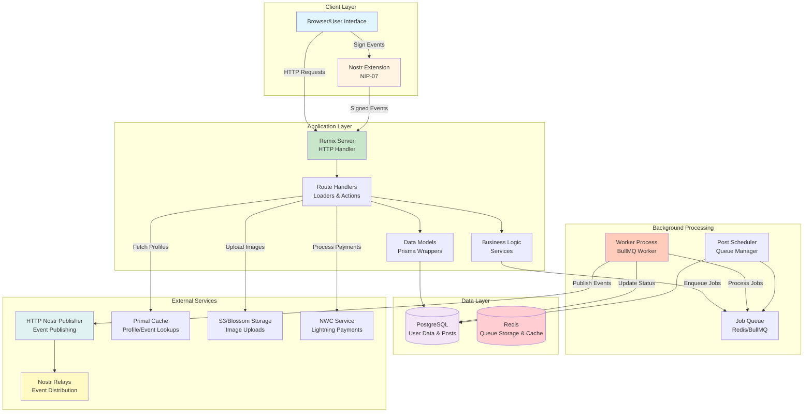
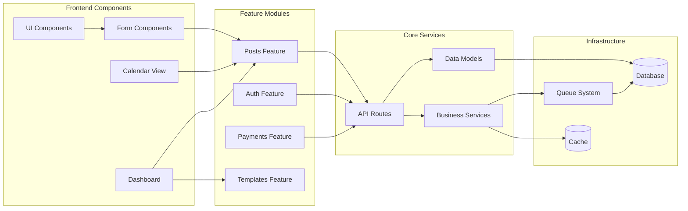
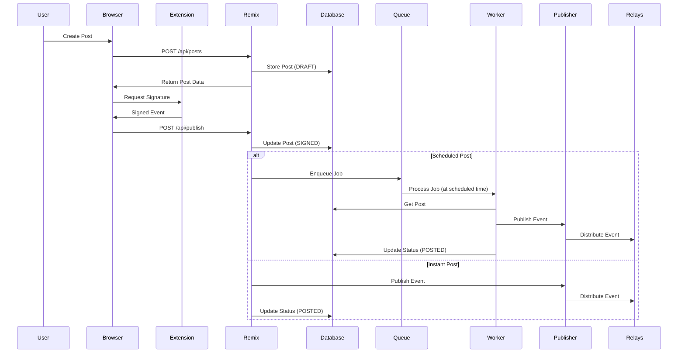

# Project Architecture

This document describes the folder structure, code organization, design patterns, and architectural
decisions of SmartFlowSocial.

## Table of Contents

- [Overview](#overview)
- [Technology Stack](#technology-stack)
- [Project Structure](#project-structure)
- [Key Conventions](#key-conventions)
- [Architectural Patterns](#architectural-patterns)
- [Data Flow](#data-flow)
- [Component Architecture](#component-architecture)
- [State Management](#state-management)
- [Error Handling](#error-handling)
- [Security Architecture](#security-architecture)
- [Performance Considerations](#performance-considerations)
- [Best Practices](#best-practices)

---

## Overview

SmartFlowSocial is built as a full-stack Remix application with a focus on:

- **Type Safety**: TypeScript throughout
- **Modularity**: Feature-based organization
- **Scalability**: Queue-based background processing
- **Security**: Client-side signing, server-side validation
- **Performance**: Optimized queries, caching strategies

## Technology Stack

| Layer          | Technology                                      |
| -------------- | ----------------------------------------------- |
| Framework      | [Remix](https://remix.run) (Full-stack React)   |
| Database       | PostgreSQL with [Prisma](https://prisma.io) ORM |
| Styling        | [TailwindCSS](https://tailwindcss.com)          |
| UI Components  | [Shadcn UI](https://ui.shadcn.com) (Radix UI)   |
| Icons          | [Lucide React](https://lucide.dev)              |
| Queue System   | [BullMQ](https://docs.bullmq.io/) with Redis    |
| Authentication | Nostr-based (NIP-07 browser extensions)         |
| Payments       | Lightning Network via NWC                       |

## System Architecture Diagram



## Project Structure

```
smartflow-social/
├── app/                          # Main application code
│   ├── components/               # Reusable UI components
│   │   ├── dashboard/           # Dashboard-specific components
│   │   ├── layout/              # Layout components (Header, Sidebar)
│   │   ├── settings/            # Settings page components
│   │   └── ui/                  # Generic UI components (Button, Input, etc.)
│   │
│   ├── features/                 # Feature-based modules
│   │   ├── assets/              # Asset management
│   │   ├── auth/                # Authentication logic
│   │   ├── cache/               # Caching utilities
│   │   ├── engagement/          # Engagement feed & notifications
│   │   ├── giveaway/            # Giveaway management
│   │   ├── payments/            # Payment processing
│   │   ├── posts/               # Post creation & scheduling (59 files)
│   │   ├── templates/           # Post templates
│   │   ├── upload/              # File upload handling
│   │   └── user/                # User management
│   │
│   ├── lib/                      # Shared utilities and helpers
│   │   ├── date.ts              # Date/time utilities
│   │   ├── encryption.server.ts # Encryption helpers
│   │   ├── helpers.ts           # General helpers
│   │   ├── nostr.ts             # Nostr protocol utilities
│   │   ├── nostrwebsocket.server.ts # WebSocket connections
│   │   ├── prisma.server.ts     # Database client
│   │   ├── relays.ts            # Nostr relay configuration
│   │   └── utils.ts             # Misc utilities
│   │
│   ├── models/                   # Database models (server-side)
│   │   ├── asset.server.ts      # Asset CRUD operations
│   │   ├── longformpost.server.ts # Long-form post operations
│   │   ├── payment.server.ts    # Payment processing
│   │   ├── post.commands.server.ts # Post write operations
│   │   ├── post.queries.server.ts  # Post read operations
│   │   ├── post.types.ts         # Post shared types
│   │   ├── template.server.ts   # Template operations
│   │   └── user.server.ts       # User management (deprecated, use ~/features/user)
│   │
│   ├── routes/                   # Remix file-based routing
│   │   ├── _index.tsx           # Landing page
│   │   ├── api.*.tsx            # API endpoints
│   │   ├── cron.*.tsx           # Cron job endpoints
│   │   ├── dashboard.*.tsx      # Dashboard pages
│   │   ├── login.tsx            # Login page
│   │   └── plans.tsx            # Subscription plans
│   │
│   ├── utils/                    # Additional utilities
│   ├── entry.client.tsx          # Client entry point
│   ├── entry.server.tsx          # Server entry point
│   ├── root.tsx                  # Root layout component
│   └── tailwind.css              # Global styles
│
├── docs/                         # Documentation
├── prisma/                       # Database configuration
│   ├── schema.prisma            # Database schema
│   ├── seed.ts                  # Database seeding
│   └── migrations/              # Database migrations
│
├── public/                       # Static assets
├── tests/                        # Test files
│   ├── integration/             # Integration tests
│   ├── unit/                    # Unit tests
│   ├── utils/                   # Test utilities
│   └── setup.ts                 # Test configuration
│
├── server.ts                     # Express server entry
├── worker.ts                     # BullMQ worker process
└── [config files]                # Various configuration files
```

## Key Conventions

### UI and Icons

- **Icons**: Use [Lucide React](https://lucide.dev) only. Use `size-4` for inline icons (e.g. in
  buttons), or `className="h-X w-X"` where needed for layout.
- **Navigation icons**: Icons in sidebar/primary nav must feel as strong as the text — never
  decorative. Use **18px** size and **strokeWidth 2.25** for all nav icons (see
  `NAV_ICON_SIZE_CLASS` / `NAV_ICON_STROKE` in `DashboardHeader` and `ExpandableNavigationSection`).
  Use slightly higher contrast for inactive nav icons (e.g. `text-foreground/70`) so they read
  co-equal with labels.
- **Stroke**: Use a single stroke width per context: default `strokeWidth={2}` elsewhere; nav uses
  `2.25` to match Kanit. Do not mix stroke widths randomly.
- **Icon semantics (one concept = one icon)**:
  - **Create** → `Plus` (sidebar Create section and dashboard Compose). Do not use Upload for
    “create”.
  - **New post (kind 1 note)** → `MessageSquare`. **New long-form** → `FileText`. **Drafts** (state)
    → `FilePenLine`. **Templates** → `Copy`. **Bulk / batch** → `LayoutGrid`.
  - **Engagement** (domain) → `Flame`. **Engagement Feed** (child) → `Rss`. **Giveaway** → `Gift`.
  - **Time / scheduled** → `Clock` or `CalendarDays`. **Published / done** → `Check`. **Settings** →
    `Settings`. **Dashboard home** → `Home`.
  - Sidebar = domains + content types; use state-style icons (e.g. FilePenLine for drafts) so state
    is not mixed with types. Dashboard = status + action only.
- **UI primitives**: Use Shadcn/Radix components from `~/components/ui` (Alert, AlertDialog, Dialog,
  DropdownMenu, Popover, Separator, Skeleton, Tooltip, etc.) for consistency and accessibility.

### File Naming

- **Routes**: Lowercase with dots for nesting (`dashboard.settings.tsx`)
- **Components**: PascalCase (`PostBlock.tsx`)
- **Utilities**: camelCase (`helpers.ts`)
- **Server-only**: `.server.ts` suffix

### Route Structure

Remix uses file-based routing with dot notation:

- `dashboard.tsx` → Layout wrapper for `/dashboard/*`
- `dashboard._index.tsx` → `/dashboard` (index)
- `dashboard.settings.tsx` → `/dashboard/settings`
- `dashboard.calendar.$queueType.tsx` → `/dashboard/calendar/:queueType`

### Server vs Client Code

- Files with `.server.ts` run only on the server
- Keep Prisma database operations in `models/` directory
- Use `loader` functions for data fetching, `action` functions for mutations

### Remix Loaders and Actions

This project follows the standard **Remix Run** pattern where route files contain two key
server-side functions:

#### `loader` Function

- Runs on **GET requests** before the component renders
- Fetches data from the database via model functions
- Returns data that the component receives via `useLoaderData()`
- Contains business logic for data validation and transformation

```typescript
// Example: app/routes/dashboard.posts.tsx
export async function loader({ request }: LoaderFunctionArgs) {
  const user = await requireUser(request); // Auth check
  const posts = await getScheduledPosts({ userId: user.id }); // Model call
  return json({ posts, user }); // Return to component
}
```

#### `action` Function

- Runs on **POST/PUT/DELETE requests** (form submissions)
- Handles mutations (create, update, delete operations)
- Contains business logic for validation and processing
- Typically redirects or returns updated data after completion

```typescript
// Example: app/routes/dashboard.posts.tsx
export async function action({ request }: ActionFunctionArgs) {
  const user = await requireUser(request);
  const formData = await request.formData();
  const intent = formData.get("intent");

  if (intent === "delete") {
    await deletePost({ id: formData.get("postId"), userId: user.id });
    return json({ success: true });
  }
  // ... other intents
}
```

#### Where Logic Lives

| Layer                        | Responsibility                            | Example                                            |
| ---------------------------- | ----------------------------------------- | -------------------------------------------------- |
| **Routes (loaders/actions)** | Business logic, validation, orchestration | Auth checks, permission validation, combining data |
| **Models**                   | Database operations (Prisma wrappers)     | `createPost()`, `getUserById()`, `deletePost()`    |
| **Features**                 | Reusable domain logic                     | Post publishing, payment processing                |
| **Lib**                      | Utilities and helpers                     | Encryption, date formatting, Nostr utilities       |

## Data Flow

```
┌─────────────────────────────────────────────────────────────┐
│                        Browser                               │
│  ┌─────────────┐    ┌─────────────┐    ┌─────────────────┐  │
│  │   React     │    │   Nostr     │    │    Wallet       │  │
│  │ Components  │    │ Extension   │    │  (Alby/Amber)   │  │
│  └──────┬──────┘    └──────┬──────┘    └────────┬────────┘  │
└─────────┼──────────────────┼───────────────────┼────────────┘
          │                  │                   │
          ▼                  ▼                   ▼
┌─────────────────────────────────────────────────────────────┐
│                    Remix Server                              │
│  ┌─────────────┐    ┌─────────────┐    ┌─────────────────┐  │
│  │   Routes    │───▶│   Models    │───▶│     Prisma      │  │
│  │  (loaders/  │    │  (database  │    │   (PostgreSQL)  │  │
│  │  actions)   │    │ operations) │    │                 │  │
│  └─────────────┘    └─────────────┘    └─────────────────┘  │
└─────────────────────────────────────────────────────────────┘
          │
          ▼
┌─────────────────────────────────────────────────────────────┐
│                   External Services                          │
│  ┌─────────────┐    ┌─────────────┐    ┌─────────────────┐  │
│  │  PostgreSQL │    │    Redis    │    │  Nostr Relays   │  │
│  │  (data)     │    │  (queues)   │    │  (publishing)   │  │
│  └─────────────┘    └─────────────┘    └─────────────────┘  │
└─────────────────────────────────────────────────────────────┘
```

### Component Architecture Diagram



## Data Flow

The application follows a clear data flow pattern:

### Data Flow Diagram



## Architectural Patterns

### Feature-Based Organization

The codebase is organized by features rather than technical layers:

```
app/features/
├── posts/          # Post management feature
│   ├── components/ # Feature-specific components
│   ├── services/   # Business logic
│   ├── types.ts    # Feature types
│   └── ...
├── auth/           # Authentication feature
├── payments/       # Payment processing
└── ...
```

**Benefits:**

- Easy to locate feature code
- Clear feature boundaries
- Simplified refactoring
- Better code organization

### Server vs Client Code

**Server-Only Files:**

- Files with `.server.ts` suffix
- Database operations
- Authentication logic
- External API calls

**Client-Side Files:**

- React components (`.tsx`)
- Client-side utilities
- UI logic

**Shared Code:**

- Type definitions
- Constants
- Utility functions (if safe)

### Remix Patterns

#### Loader Pattern

Loaders fetch data before rendering:

```typescript
export async function loader({ request }: LoaderFunctionArgs) {
  // 1. Authenticate
  const user = await requireUser(request);

  // 2. Fetch data
  const posts = await getScheduledPosts({ userId: user.id });

  // 3. Transform if needed
  const formattedPosts = posts.map(formatPost);

  // 4. Return data
  return json({ posts: formattedPosts, user });
}
```

#### Action Pattern

Actions handle mutations:

```typescript
export async function action({ request }: ActionFunctionArgs) {
  // 1. Authenticate
  const user = await requireUser(request);

  // 2. Parse form data
  const formData = await request.formData();
  const intent = formData.get("intent");

  // 3. Validate
  if (!intent) {
    throw new ValidationError("Intent required");
  }

  // 4. Process
  if (intent === "create") {
    await createPost({ userId: user.id, ...data });
  }

  // 5. Return response
  return json({ success: true });
}
```

#### Error Boundaries

Remix provides error boundaries for error handling:

```typescript
export function ErrorBoundary() {
  const error = useRouteError();
  return <ErrorDisplay error={error} />;
}
```

## Component Architecture

### Component Hierarchy

```
Root
├── Layout
│   ├── Header
│   ├── Navigation
│   └── Content
│       ├── Route Components
│       └── Feature Components
└── Error Boundaries
```

### Component Types

1. **Layout Components**: Structure and navigation
2. **Route Components**: Page-level components
3. **Feature Components**: Domain-specific UI
4. **UI Components**: Reusable primitives

### Component Patterns

**Container/Presentational:**

- Containers: Handle data fetching and logic
- Presentational: Pure UI components

**Compound Components:**

- Components that work together (Card, Dialog, Tabs)

**Render Props:**

- Components that accept render functions

## State Management

### Server State

- Managed by Remix loaders/actions
- Fetched on navigation
- Cached by Remix

### Client State

- React hooks (`useState`, `useReducer`)
- Form state via Remix `useFetcher`
- Optimistic updates

### Global State

- User session (server-side)
- Feature flags (server-side)
- UI preferences (localStorage)

## Error Handling

### Error Hierarchy

```
Error (base)
├── ValidationError
├── NotFoundError
├── UnauthorizedError
├── DatabaseError
└── ExternalServiceError
```

### Error Flow

1. **Error Occurs**: In loader/action
2. **Error Caught**: By error handler
3. **Error Logged**: To error logger
4. **Error Returned**: To client
5. **Error Displayed**: In error boundary

See [Troubleshooting Guide](../troubleshooting/errors.md) for details.

## Security Architecture

### Authentication Flow

```
User → Extension → Sign Challenge → Server Verify → Session
```

### Authorization

- Route-level: `requireUser()`
- Resource-level: Check ownership
- Feature-level: Plan-based access

### Data Validation

- Client-side: UX feedback
- Server-side: Security validation
- Database: Constraints

See [Security Guide](../guides/security.md) for details.

## Performance Considerations

### Database Optimization

- Indexes on frequently queried columns
- Connection pooling
- Query optimization
- Pagination

### Caching Strategy

- HTTP caching headers
- Application-level caching
- Redis caching (optional)

### Frontend Optimization

- Code splitting
- Lazy loading
- Image optimization
- Bundle size optimization

See [Performance Guide](../reference/performance.md) for details.

## Worker Process

The application runs two processes:

1. **Main Server** (`server.ts`) - Handles HTTP requests
2. **Worker** (`worker.ts`) - Processes background jobs via BullMQ

### Worker Responsibilities

- Processing scheduled posts
- Publishing to Nostr relays
- Handling async tasks
- Queue management

### Process Communication

- **Shared Database**: PostgreSQL
- **Shared Queue**: Redis/BullMQ
- **No Direct Communication**: Processes are independent

### Scaling Workers

- Run multiple worker instances
- Workers automatically share queue
- Load distributed across workers

See [Posting Guide](../guides/user-guides/posting.md#queue-types) for queue system details.

## Best Practices

### Code Organization

1. **Feature-Based**: Organize by domain
2. **Co-location**: Keep related code together
3. **Separation of Concerns**: Clear boundaries
4. **DRY**: Don't repeat yourself

### Type Safety

1. **TypeScript**: Use throughout
2. **Type Definitions**: Shared types
3. **Type Inference**: Leverage TypeScript
4. **Type Guards**: Runtime validation

### Testing

1. **Unit Tests**: Test functions/components
2. **Integration Tests**: Test loaders/actions
3. **E2E Tests**: Test user workflows
4. **Property Tests**: Test edge cases

### Documentation

1. **Code Comments**: Explain why, not what
2. **Type Definitions**: Self-documenting
3. **README Files**: Feature documentation
4. **API Documentation**: Endpoint docs

---

## Additional Resources

- [Remix Documentation](https://remix.run/docs)
- [Prisma Documentation](https://www.prisma.io/docs)
- [BullMQ Documentation](https://docs.bullmq.io/)
- [Database Schema](../reference/database-schema.md)
- [API Reference](../reference/api.md)
- [Deployment Guide](../guides/deployment.md)

## See Also

- [Installation Guide](./installation.md) - Configuration and setup
- [Core Concepts](./concepts.md) - Understanding the system
- [Security Guide](../guides/security.md) - Security architecture
- [Performance Guide](../reference/performance.md) - Performance considerations
- [Configuration Reference](../reference/configuration.md) - All configuration options
