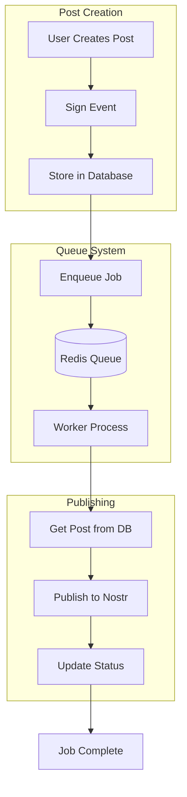
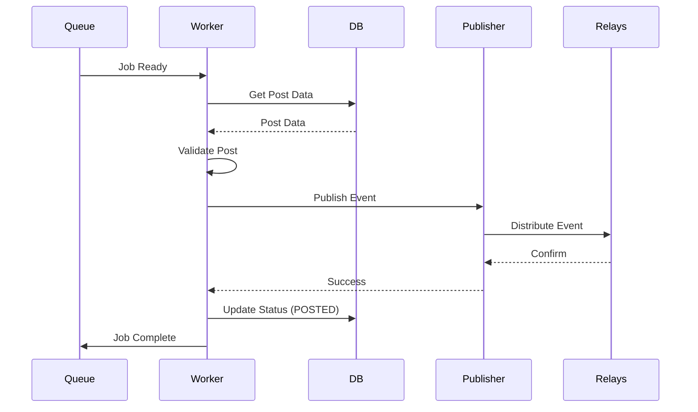

# Operations Guide

**Estimated time:** 45 minutes  
**Difficulty:** Intermediate  
**Last updated:** 2025-03-12

Complete guide to operating SmartFlowSocial in production, including monitoring, logging, alerting,
and maintenance.

## Table of Contents

- [Overview](#overview)
- [Health Checks](#health-checks)
- [Logging](#logging)
- [Monitoring](#monitoring)
- [Metrics](#metrics)
- [Alerting](#alerting)
- [Performance Monitoring](#performance-monitoring)
- [SLO Budgets and Burn-Rate Alerts](#slo-budgets-and-burn-rate-alerts)
- [Error Tracking](#error-tracking)
- [Database Monitoring](#database-monitoring)
- [Database Query Governance Loop](#database-query-governance-loop)
- [Queue Monitoring](#queue-monitoring)
- [Queue SLOs](#queue-slos)
- [Resilience Drills and Release Readiness](#resilience-drills-and-release-readiness)
- [Maintenance Tasks](#maintenance-tasks)
- [Backup & Recovery](#backup--recovery)

---

## Overview

SmartFlowSocial provides several built-in monitoring and observability features:

- ✅ Health check endpoint (`/healthcheck`)
- ✅ Prometheus metrics endpoints (`/metrics`)
- ✅ Error metrics API (`/api/error-metrics`)
- ✅ Structured logging
- ✅ Error tracking

---

## Health Checks

### Application Health Check

The application provides a health check endpoint at `/healthcheck`.

**Endpoint:** `GET /healthcheck`

**Response:**

- `200 OK` - Application is healthy
- `500 ERROR` - Application is unhealthy

**What it checks:**

1. Database connectivity (queries `countUsers()`)
2. Self-connectivity (HEAD request to root)

**Usage:**

```bash
# Manual check
curl https://your-domain.com/healthcheck

# With monitoring service
# Configure to check every 30 seconds
```

### Integration with Monitoring Services

#### UptimeRobot

1. Add new monitor
2. Type: HTTP(s)
3. URL: `https://your-domain.com/healthcheck`
4. Interval: 5 minutes
5. Alert: Email/SMS on failure

#### Pingdom

1. Create HTTP check
2. URL: `https://your-domain.com/healthcheck`
3. Expected status: 200
4. Check interval: 1 minute

#### Custom Health Check Script

```bash
#!/bin/bash
HEALTH_URL="https://your-domain.com/healthcheck"
RESPONSE=$(curl -s -o /dev/null -w "%{http_code}" $HEALTH_URL)

if [ $RESPONSE -eq 200 ]; then
  echo "✅ Application is healthy"
  exit 0
else
  echo "❌ Application is unhealthy (HTTP $RESPONSE)"
  exit 1
fi
```

---

## Logging

### Log Levels

The application uses standard log levels:

- **ERROR**: Errors that need attention
- **WARN**: Warnings about potential issues
- **INFO**: General informational messages
- **DEBUG**: Debug information (development only)

### Log Format

Logs are structured and include:

- Timestamp
- Log level
- Message
- Context (request path, user ID, etc.)

### Accessing Logs

#### PM2

```bash
# View all logs
pm2 logs

# View specific app logs
pm2 logs smartflow

# View worker logs
pm2 logs smartflow-worker

# Follow logs in real-time
pm2 logs --lines 100

# Error logs only
pm2 logs --err
```

#### Docker

```bash
# View application logs
docker logs smartflow-app

# View worker logs
docker logs smartflow-worker

# Follow logs
docker logs -f smartflow-app

# Last 100 lines
docker logs --tail 100 smartflow-app
```

#### Systemd

```bash
# View logs
journalctl -u smartflow -f

# Last 100 lines
journalctl -u smartflow -n 100

# Error logs only
journalctl -u smartflow -p err
```

### Log Aggregation

For production, consider using log aggregation services:

#### Options:

1. **Datadog**: Comprehensive logging and monitoring
2. **Sentry**: Error tracking and logging
3. **Logtail**: Simple log aggregation
4. **Papertrail**: Cloud-based log management
5. **ELK Stack**: Self-hosted (Elasticsearch, Logstash, Kibana)

#### Example: Sending Logs to External Service

```typescript
// In error logger
import { logError } from "~/lib/error-logger.server";

// Logs are automatically structured
logError(error, {
  path: request.url,
  userId: user.id,
  // Additional context
});
```

---

## Monitoring

### Prometheus Metrics

The application exposes Prometheus metrics on:

- **Web**: port `3010` (configurable via `METRICS_PORT`)
- **Worker**: port `WORKER_METRICS_PORT` (disabled unless set)

**Endpoint:** `GET /metrics`

**Access:**

```bash
curl http://localhost:3010/metrics
```

#### Worker metrics (separate process)

When `WORKER_METRICS_PORT` is set, the worker exposes its own `/metrics` endpoint. You can secure it
via `METRICS_TOKEN` and `METRICS_ALLOWED_IPS`.

```bash
curl "http://localhost:${WORKER_METRICS_PORT}/metrics"
```

**Default Metrics:**

- `http_requests_total` - Total HTTP requests
- `http_request_duration_seconds` - Request duration
- `http_requests_in_flight` - In-flight requests
- `process_cpu_user_seconds_total` - CPU usage
- `process_resident_memory_bytes` - Memory usage
- `nodejs_heap_size_total_bytes` - Heap size

### Setting Up Prometheus

#### 1. Install Prometheus

```bash
# Download from https://prometheus.io/download/
wget https://github.com/prometheus/prometheus/releases/download/v2.45.0/prometheus-2.45.0.linux-amd64.tar.gz
tar xvfz prometheus-*.tar.gz
cd prometheus-*
```

#### 2. Configure `prometheus.yml`

```yaml
global:
  scrape_interval: 15s

scrape_configs:
  - job_name: "smartflow"
    static_configs:
      - targets: ["localhost:3010"]
```

#### 3. Start Prometheus

```bash
./prometheus --config.file=prometheus.yml
```

#### 4. Access Grafana Dashboard

- Prometheus UI: `http://localhost:9090`
- Grafana: `http://localhost:3000` (if installed)

### Grafana Dashboard

Create a Grafana dashboard with key metrics:

1. **Request Rate**: `rate(http_requests_total[5m])`
2. **Error Rate**: `rate(http_requests_total{status=~"5.."}[5m])`
3. **Response Time**: `histogram_quantile(0.95, http_request_duration_seconds_bucket)`
4. **Memory Usage**: `process_resident_memory_bytes`
5. **CPU Usage**: `rate(process_cpu_user_seconds_total[5m])`

---

## Metrics

### Error Metrics

The application provides error metrics via API:

**Endpoint:** `GET /api/error-metrics`

**Query Parameters:**

- `summary=true` - Get summary with error rate
- `top=10` - Get top N error codes
- `checkRate=true` - Check if error rate is high

**Example:**

```bash
# Get summary
curl https://your-domain.com/api/error-metrics?summary=true

# Get top 10 errors
curl https://your-domain.com/api/error-metrics?top=10

# Check error rate
curl https://your-domain.com/api/error-metrics?checkRate=true
```

**Response (summary):**

```json
{
  "summary": {
    "totalErrors": 150,
    "errorsByCode": {
      "VALIDATION_ERROR": 45,
      "NOT_FOUND": 32,
      "DATABASE_ERROR": 28
    },
    "errorsByType": {
      "ValidationError": 45,
      "NotFoundError": 32
    }
  },
  "errorRate": {
    "perMinute": 5.2,
    "isHigh": false,
    "threshold": 10
  }
}
```

### Custom Metrics

Add custom metrics using Prometheus client:

```typescript
import { prom } from "@isaacs/express-prometheus-middleware";

// Metrics are automatically collected
// Add custom metrics as needed
```

---

## Alerting

### Setting Up Alerts

#### Prometheus Alertmanager

1. **Install Alertmanager**

```bash
wget https://github.com/prometheus/alertmanager/releases/download/v0.26.0/alertmanager-0.26.0.linux-amd64.tar.gz
tar xvfz alertmanager-*.tar.gz
```

2. **Configure Alerts in Prometheus**

```yaml
# prometheus.yml
rule_files:
  - alerts.yml

# alerts.yml
groups:
  - name: smartflow_alerts
    rules:
      - alert: HighErrorRate
        expr: rate(http_requests_total{status=~"5.."}[5m]) > 0.1
        for: 5m
        annotations:
          summary: "High error rate detected"

      - alert: HighMemoryUsage
        expr: process_resident_memory_bytes > 2e9
        for: 5m
        annotations:
          summary: "High memory usage"

      - alert: ApplicationDown
        expr: up{job="smartflow"} == 0
        for: 1m
        annotations:
          summary: "Application is down"
```

3. **Configure Alertmanager**

```yaml
# alertmanager.yml
route:
  receiver: "email"
  group_wait: 10s
  group_interval: 10s
  repeat_interval: 12h

receivers:
  - name: "email"
    email_configs:
      - to: "admin@example.com"
        from: "alerts@example.com"
        smarthost: "smtp.example.com:587"
        auth_username: "alerts@example.com"
        auth_password: "password"
```

### Key Metrics to Alert On

1. **Application Down**: Health check fails
2. **High Error Rate**: > 10 errors/minute
3. **High Response Time**: P95 > 2 seconds
4. **High Memory Usage**: > 80% of available
5. **Database Connection Issues**: Connection errors
6. **Queue Backlog**: > 1000 jobs waiting
7. **Worker Down**: Worker process not running

---

## Performance Monitoring

### Key Performance Indicators (KPIs)

1. **Response Time**
   - P50 (median): < 200ms
   - P95: < 500ms
   - P99: < 1s

2. **Throughput**
   - Requests per second
   - Jobs processed per minute

3. **Error Rate**
   - < 1% of requests
   - < 10 errors per minute

4. **Resource Usage**
   - CPU: < 70% average
   - Memory: < 80% of available
   - Database connections: < 80% of pool

### Performance Monitoring Tools

#### Application Performance Monitoring (APM)

1. **New Relic**: Comprehensive APM
2. **Datadog APM**: Full-stack monitoring
3. **Sentry Performance**: Error tracking + performance
4. **Lighthouse CI**: Frontend performance

#### Database Performance

Monitor database queries:

```sql
-- Slow queries
SELECT query, mean_exec_time, calls
FROM pg_stat_statements
ORDER BY mean_exec_time DESC
LIMIT 10;

-- Connection stats
SELECT count(*), state
FROM pg_stat_activity
GROUP BY state;
```

---

## SLO Budgets and Burn-Rate Alerts

SmartFlowSocial uses explicit SLO targets and burn-rate alerts for release readiness.

### SLO targets

- API availability: **99.9%** success (5xx budget: 0.1%)
- API latency: **p95 < 500ms**, **p99 < 1s**
- Database query latency: **p95 < 100ms**
- Scheduled queue lateness: **p95 < 300s**
- Outbox freshness: oldest ready event age **< 120s**

### Alert rules source

Primary rules are versioned in
[`docs/monitoring/queue-slo-alerts.yml`](../monitoring/queue-slo-alerts.yml).

### Burn-rate model

- **Fast burn** catches acute incidents and pages immediately.
- **Slow burn** catches chronic degradation before budget exhaustion.
- Both must be wired to an incident channel with owner rotation.

### Recommended release policy

- Block deploy if any critical SLO alert is firing.
- Require a rollback/mitigation note for any warning alert that persists > 1 hour.
- Track per-release SLO impact in weekly ops review.

---

## Error Tracking

### Built-in Error Tracking

The application includes error tracking in `app/lib/error-metrics.server.ts`:

- Tracks error counts by code and type
- Calculates error rates
- Provides error summaries

### External Error Tracking

#### Sentry Integration

1. **Install Sentry**

```bash
pnpm add @sentry/remix
```

2. **Configure in `app/entry.server.tsx`**

```typescript
import * as Sentry from "@sentry/remix";

Sentry.init({
  dsn: process.env.SENTRY_DSN,
  environment: process.env.NODE_ENV,
  tracesSampleRate: 1.0,
});
```

3. **Add to Error Handler**

```typescript
import { logError } from "~/lib/error-logger.server";

try {
  // Your code
} catch (error) {
  logError(error, { path: request.url });
  Sentry.captureException(error);
  throw error;
}
```

---

## Database Monitoring

### Key Metrics

1. **Connection Pool**
   - Active connections
   - Idle connections
   - Connection wait time

2. **Query Performance**
   - Slow queries
   - Query frequency
   - Cache hit rate

3. **Database Size**
   - Table sizes
   - Index sizes
   - Growth rate

### Monitoring Queries

```sql
-- Active connections
SELECT count(*) FROM pg_stat_activity;

-- Database size
SELECT pg_size_pretty(pg_database_size('smartflow'));

-- Table sizes
SELECT
  schemaname,
  tablename,
  pg_size_pretty(pg_total_relation_size(schemaname||'.'||tablename)) AS size
FROM pg_tables
WHERE schemaname = 'public'
ORDER BY pg_total_relation_size(schemaname||'.'||tablename) DESC;
```

### Prisma Studio

Monitor database in real-time:

```bash
pnpm exec prisma studio
```

Access at `http://localhost:5555`

---

## Database Query Governance Loop

Use `prisma_query_duration_ms` and `prisma_slow_query_total` as the canonical query SLI set.

### Weekly loop

1. Identify top offenders:
   - `histogram_quantile(0.95, sum(rate(prisma_query_duration_ms_bucket[7d])) by (le, model, action))`
   - `sum(rate(prisma_slow_query_total[7d])) by (model, action)`
2. Correlate with release changelog and recent migrations.
3. Apply one of:
   - Query shape/select minimization
   - Index addition or adjustment
   - Read model/backfill strategy
4. Verify with `scripts/VERIFY_INDEXES.sql` and post-change p95 delta.

### Escalation

- If p95 query latency > 100ms for 24h, treat as release blocker for DB-touching changes.
- If slow-query rate increases release-over-release, require remediation issue before next cut.

---

## Queue System

The application uses BullMQ with Redis for background job processing.

### Queue Processing Architecture



### Worker Process Flow



## Queue Monitoring

See [Queue System Documentation](./queue-system.md) for detailed queue monitoring.

### Key Metrics

1. **Queue Length**: Jobs waiting to be processed
2. **Processing Rate**: Jobs processed per minute
3. **Failed Jobs**: Jobs that failed processing
4. **Processing Time**: Average job processing time

### Monitoring Commands

```bash
# Redis CLI
redis-cli -u $REDIS_URL

# Check queue length
LLEN bull:scheduled-posts:waiting

# Get job counts
KEYS bull:*
```

## Queue SLOs

Queue and outbox SLOs are enforced by alert rules in
[`docs/monitoring/queue-slo-alerts.yml`](../monitoring/queue-slo-alerts.yml).

Primary queue SLIs:

- `publish_lateness_seconds`
- `outbox_oldest_ready_age_seconds`
- `outbox_events_dead_lettered_total`
- `queue_oldest_waiting_age_seconds{queue=~"scheduled-posts|scheduled-longform-posts"}`

Operational response expectations:

- Critical queue alerts: triage within 15 minutes.
- Warning queue alerts: triage within 1 hour.
- Any queue alert > 4h: create follow-up remediation task with owner/date.

---

## Resilience Drills and Release Readiness

SmartFlowSocial uses scheduled resilience drills as a hard input to release decisions.

Runbook:

- [`docs/runbooks/performance-resilience-drills.md`](../runbooks/performance-resilience-drills.md)

Minimum release gate:

- Latest required drill completed.
- No unresolved critical findings from latest drill.
- CI performance and budget checks passing.
- No active critical SLO burn alerts.

---

## Maintenance Tasks

### Daily Tasks

- [ ] Check error metrics
- [ ] Review application logs
- [ ] Verify health checks
- [ ] Check queue status

### Weekly Tasks

- [ ] Review performance metrics
- [ ] Check database size
- [ ] Review failed jobs
- [ ] Update dependencies (if needed)

### Monthly Tasks

- [ ] Review and optimize slow queries
- [ ] Clean up old logs
- [ ] Review and update monitoring alerts
- [ ] Performance review
- [ ] Security audit

---

## Backup & Recovery

### Database Backups

#### Automated Backups

**PostgreSQL:**

```bash
# Daily backup script
#!/bin/bash
DATE=$(date +%Y%m%d)
pg_dump $DATABASE_URL > /backups/smartflow-$DATE.sql
gzip /backups/smartflow-$DATE.sql

# Keep last 30 days
find /backups -name "smartflow-*.sql.gz" -mtime +30 -delete
```

**Cron Job:**

```bash
# Add to crontab
0 2 * * * /path/to/backup-script.sh
```

#### Manual Backups

```bash
# Full backup
pg_dump $DATABASE_URL > backup.sql

# Restore
psql $DATABASE_URL < backup.sql
```

### Redis Backups

```bash
# Save Redis data
redis-cli -u $REDIS_URL SAVE

# Copy RDB file
cp /var/lib/redis/dump.rdb /backups/redis-$(date +%Y%m%d).rdb
```

### Recovery Procedures

1. **Database Recovery**

   ```bash
   # Stop application
   pm2 stop smartflow

   # Restore database
   psql $DATABASE_URL < backup.sql

   # Restart application
   pm2 start smartflow
   ```

2. **Redis Recovery**

   ```bash
   # Stop Redis
   redis-cli -u $REDIS_URL SHUTDOWN

   # Copy backup
   cp /backups/redis-20240101.rdb /var/lib/redis/dump.rdb

   # Start Redis
   redis-server
   ```

---

## Repository hygiene and packaging

When creating source zips or tarballs (e.g. for audits or distribution), exclude the following so
archives stay small and do not leak history or local junk:

- `.git`
- `.git-backup*`, `.git.backup.*`
- `__MACOSX`
- `.pnpm-store`
- `node_modules`, `coverage`, `test-results`, `build`

These patterns are listed in `.gitignore`. Do not commit backup directories or generated artifacts;
CI is the source of truth for test status.

---

## Additional Resources

- [Deployment Guide](./deployment.md)
- [Posting Guide](./user-guides/posting.md#queue-types) - Queue system documentation
- [Troubleshooting Guide](../troubleshooting/common-issues.md)
- [Troubleshooting Errors](../troubleshooting/errors.md)
- [Performance Resilience Drills](../runbooks/performance-resilience-drills.md)
