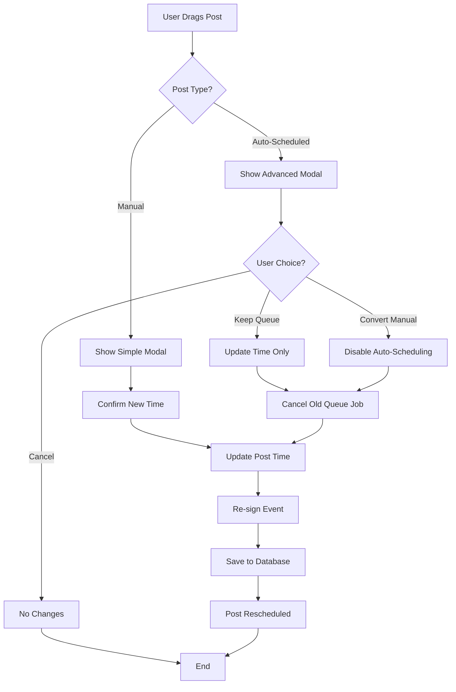

# Calendar Guide

**Estimated time:** 20 minutes  
**Difficulty:** Beginner  
**Last updated:** 2025-03-12

Complete guide to using the visual calendar interface for scheduling posts in SmartFlowSocial.

## Table of Contents

- [Overview](#overview)
- [Features](#features)
- [Calendar Views](#calendar-views)
- [Post Blocks](#post-blocks)
- [Drag & Drop](#drag--drop)
- [Queue Override System](#queue-override-system)
- [Usage Guide](#usage-guide)
- [Best Practices](#best-practices)
- [Troubleshooting](#troubleshooting)
- [Technical Details](#technical-details)

---

## Overview

The calendar feature provides a Notion-style visual interface for managing scheduled posts with
drag-and-drop functionality and smart queue override logic. It's designed for users who prefer
visual content management over list-based interfaces.

## Features

### 📅 Calendar Views

- **Weekly View**: Horizontal day layout (Mon-Sun) with hourly time slots (00:00-23:59)
- **Monthly View**: Standard calendar grid with post cards under each date
- **Navigation**: Previous/next navigation and "Today" button
- **Current Time Indicator**: Red line showing current time in weekly view

### 🧱 Post Blocks

- **Visual Representation**: Shows post preview, type icons, and scheduling time
- **Image Thumbnails**: Displays image previews for posts with media (supports various formats)
- **Status Indicators**:
  - Blue gear icon for auto-scheduled posts
  - Green checkmark for signed posts
  - Color-coded backgrounds based on scheduling type
- **Drag and Drop**: Full drag-and-drop support with visual feedback
- **Responsive Thumbnails**: Different thumbnail sizes for different views (minimal, compact, full)

### 🖱 Drag & Drop Logic

The system intelligently handles two types of scheduled posts:

#### Manual Posts (Simple Flow)

```
User drags post → Simple confirmation modal → Update time
```

#### Auto-Scheduled Posts (Advanced Flow)

```
User drags post → Advanced modal with options:
- "Cancel" - No changes
- "Keep Queue Rule" - Update time but keep auto-scheduling
- "Convert to Manual" - Update time and disable auto-scheduling
```

### Calendar Drag & Drop Process



### ⚙️ Queue Override System

- **`manual_override` field**: New boolean field in Post model
- **Queue Integration**: Automatically cancels old scheduled jobs when rescheduling
- **Event Re-signing**: Clears signed events when time changes (requires client re-signing)
- **Smart Detection**: Automatically detects if posts were auto-scheduled

## Database Changes

### New Field Added

```prisma
model Post {
  // ... existing fields
  manual_override Boolean @default(false)
}
```

### Migration

```bash
pnpm exec prisma db push
```

## API Endpoints

### POST /dashboard/calendar

Handles post rescheduling with the following form data:

- `action`: "reschedule"
- `postId`: ID of the post to reschedule
- `newTime`: New timestamp in Unix seconds
- `overrideQueue`: "true" or "false"

## File Structure

```
app/components/calendar/
├── Calendar.jsx           # Main calendar container
├── WeeklyView.jsx        # Weekly view implementation
├── MonthlyView.jsx       # Monthly view implementation
├── PostBlock.jsx         # Draggable post components
├── RescheduleModal.jsx   # Confirmation modals
├── calendar.css          # Calendar-specific styles
└── index.js              # Component exports

app/routes/
└── dashboard.calendar.jsx # Main calendar route
```

## Usage

1. Navigate to `/dashboard/calendar`
2. Switch between Week/Month views using the toggle
3. Drag posts to new time slots
4. Confirm changes in the modal that appears
5. Posts will need to be re-signed after rescheduling

## Usage Guide

### Accessing the Calendar

1. **Navigate to Calendar**
   - Click "Calendar" in dashboard navigation
   - Or go to `/dashboard/calendar`

2. **Select Queue Type** (Optional)
   - Choose specific queue to view
   - Or view all queues together

3. **Switch Views**
   - Toggle between Weekly and Monthly views
   - Use view selector in header

### Weekly View

**Layout:**

- Horizontal timeline (Monday-Sunday)
- Hourly time slots (00:00-23:59)
- Current time indicator (red line)
- Post blocks positioned by time

**Navigation:**

- Previous/Next week buttons
- "Today" button to jump to current week
- Date range display

**Interactions:**

- Click post block to view details
- Drag post to reschedule
- Hover for quick preview

### Monthly View

**Layout:**

- Traditional calendar grid
- Days of the month
- Post cards under each date
- Color-coded by queue

**Navigation:**

- Previous/Next month buttons
- "Today" button
- Month/year selector

**Interactions:**

- Click date to see all posts
- Click post card for details
- Drag posts between dates

### Rescheduling Posts

**Simple Reschedule (Manual Posts):**

1. **Drag Post Block**
   - Click and hold post
   - Drag to new time slot
   - Release to drop

2. **Confirm Reschedule**
   - Modal appears with new time
   - Review changes
   - Click "Confirm"

3. **Re-sign Event**
   - Extension prompts for signing
   - Sign with new timestamp
   - Post rescheduled

**Advanced Reschedule (Auto-scheduled Posts):**

1. **Drag Post Block**
   - Same as above

2. **Choose Option**
   - **Cancel**: No changes
   - **Keep Queue Rule**: Update time, keep auto-scheduling
   - **Convert to Manual**: Update time, disable auto-scheduling

3. **Confirm and Sign**
   - Confirm choice
   - Re-sign event
   - Post updated

---

## Best Practices

### Organizing Content

1. **Use Queue Colors**
   - Assign colors to queues
   - Visual organization
   - Easy identification

2. **Group Related Posts**
   - Schedule related content together
   - Use consistent times
   - Create content blocks

3. **Balance Schedule**
   - Don't overload single time slots
   - Space posts appropriately
   - Consider audience timezone

### Time Management

1. **Peak Times**
   - Schedule during peak engagement
   - Use analytics to find best times
   - Test different times

2. **Consistency**
   - Post at regular intervals
   - Use queues for automation
   - Maintain schedule

3. **Flexibility**
   - Leave room for adjustments
   - Use calendar for quick changes
   - Don't over-schedule

### Visual Organization

1. **Queue Colors**
   - Use distinct colors
   - Match brand colors if possible
   - Keep consistent

2. **Post Previews**
   - Use clear captions
   - Include relevant images
   - Make posts identifiable

---

## Troubleshooting

### Calendar Not Loading

**Symptoms:**

- Calendar view is blank
- Posts not appearing
- Loading spinner stuck

**Solutions:**

1. Refresh the page
2. Check browser console for errors
3. Verify you have scheduled posts
4. Check queue filter settings
5. Clear browser cache

### Drag and Drop Not Working

**Symptoms:**

- Can't drag posts
- Drop doesn't work
- No feedback

**Solutions:**

1. Check browser compatibility
2. Disable browser extensions
3. Try different browser
4. Check JavaScript errors
5. Verify post is scheduled (not posted)

### Posts Not Rescheduling

**Symptoms:**

- Reschedule doesn't save
- Time doesn't update
- Error messages

**Solutions:**

1. Check post has signed event
2. Verify new time is in future
3. Check network connection
4. Re-sign event if needed
5. Check queue configuration

### Performance Issues

**Symptoms:**

- Calendar loads slowly
- Lag when dragging
- Browser freezes

**Solutions:**

1. Reduce number of posts visible
2. Use queue filters
3. Close other browser tabs
4. Check browser performance
5. Update browser

See [Troubleshooting Guide](../troubleshooting/common-issues.md) for more solutions.

---

## Technical Details

### Signing Behavior

- **User-Required Signing**: All scheduled posts must be signed by the user client-side before
  scheduling
- **No Server-Side Signing**: The server does not sign events; users must approve each post with
  their Nostr key
- **Re-signing on Reschedule**: When a post is rescheduled, it must be re-signed with the new
  timestamp
- **Content Preservation**: Uses the exact same content and tags from the original signed event
- **Only Timestamp Changes**: Only the `created_at` field is updated, everything else remains
  identical
- **Client-side Signing**: Uses the same `signEventFn` as regular post creation
- **Nostr Event Integrity**: Maintains proper nostr event structure with correct timestamp
- **Job Scheduling**: Posts are only scheduled in the queue system after successful user signing
- **Unsigned Post Protection**: Prevents scheduling of posts that don't have signed events

### Queue Integration

- Auto-scheduled posts are detected by checking `manual_override` field
- Original queue jobs are cancelled when posts are rescheduled
- New jobs are scheduled only after posts are properly signed
- Queue rules are preserved unless manually overridden

### Performance Considerations

- Calendar renders efficiently with virtualized time slots
- Drag operations use requestAnimationFrame for smooth performance
- Posts are grouped by date/time for optimal rendering
- **Image Loading**: Lazy loading for thumbnails to improve performance
- **Smart Image Parsing**: Handles both JSON array and direct URL formats
- **Error Handling**: Graceful fallbacks when images fail to load
- **Memoization**: Components are memoized to prevent unnecessary re-renders
- **Debouncing**: Reschedule operations are debounced to reduce API calls

### Data Flow

```
User Drags Post
    ↓
Calculate New Time
    ↓
Show Confirmation Modal
    ↓
User Confirms
    ↓
Cancel Old Queue Job
    ↓
Clear Signed Event
    ↓
User Re-signs Event
    ↓
Update Post in Database
    ↓
Schedule New Queue Job
    ↓
Update Calendar View
```

---

## Additional Resources

- [Posting Guide](./posting.md) - How to create posts
- [Queue Types](./posting.md#queue-types) - Queue documentation
- [Nostr Integration](../reference/nostr.md) - Protocol details
- [Troubleshooting Guide](../troubleshooting/common-issues.md) - Common issues
