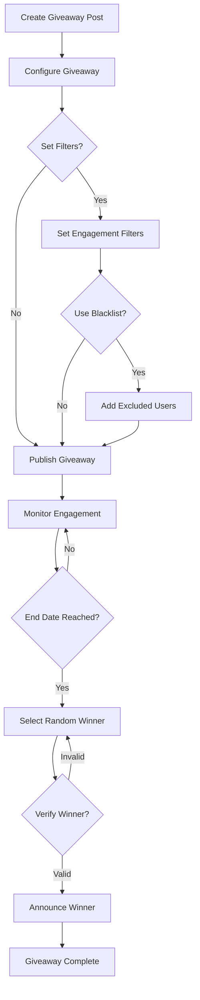

# Giveaways Guide

**Estimated time:** 20 minutes  
**Difficulty:** Beginner  
**Last updated:** 2026-01-02

Complete guide to creating and managing Nostr giveaways with fair winner selection in
SmartFlowSocial.

---

## Table of Contents

- [Overview](#overview)
- [Getting Started](#getting-started)
- [Creating Giveaways](#creating-giveaways)
- [Selecting Winners](#selecting-winners)
- [Managing Giveaways](#managing-giveaways)
- [Giveaway Filters](#giveaway-filters)
- [Blacklist Management](#blacklist-management)
- [Posting Results](#posting-results)
- [Best Practices](#best-practices)

---

## Overview

SmartFlowSocial's giveaway feature allows you to:

- **Track engagement** on your posts (likes, reposts, comments, zaps)
- **Select random winners** fairly from participants
- **Filter participants** by engagement type
- **Manage blacklists** to exclude specific accounts
- **Post results** automatically with winner announcements

### How It Works

1. **Post content** to Nostr (memes, announcements, etc.)
2. **Track engagement** (likes, reposts, comments, zaps)
3. **Select winners** randomly from participants
4. **Post results** announcing winners

---

## Getting Started

### Prerequisites

- **Active subscription** (Free plan has access to giveaways)
- **Posted content** with engagement
- **Nostr extension** for signing results

### Accessing Giveaways

1. Click **"Giveaways"** in the navigation
2. View your posts with engagement
3. Select a post to create a giveaway

---

## Creating Giveaways

### Giveaway Workflow



### Step 1: View Posts with Engagement

1. Go to **Giveaways** page
2. See all your posted content with engagement
3. Posts are sorted by total engagement
4. Filter by queue type or time period

### Step 2: Select a Post

1. Click on a post with engagement
2. View engagement statistics:
   - **Likes** - Number of likes
   - **Reposts** - Number of reposts
   - **Comments** - Number of replies
   - **Zaps** - Number of zaps and total sats

### Step 3: Configure Giveaway

1. **Set time period:**
   - Last 7 days (default)
   - Last 14 days
   - Last 30 days
   - Custom range

2. **Filter by queue:**
   - All queues
   - Specific queue type

3. **View participants:**
   - See all users who engaged
   - Filter by engagement type

---

## Selecting Winners

### Random Winner Selection

SmartFlowSocial uses a fair random selection process:

1. **Group participants** by engagement type:
   - Reposters (kind 6)
   - Likers (kind 7, 9735, 9734)
   - Commenters (kind 1)

2. **Select random winners:**
   - 3 random reposters
   - 3 random likers
   - 3 random commenters

3. **Display winners:**
   - See selected winners
   - View their profiles
   - Copy winner list

### Winner Selection Process

**How it works:**

- Random selection from each category
- No bias or favoritism
- Transparent process
- Verifiable results

**Example:**

```
✅ 3 random reposts from last week each got 2,000 sats
✅ 3 random reactions from last week each got 1,000 sats
✅ 3 random comments from last week each got 1,000 sats
```

---

## Managing Giveaways

### Giveaway Dashboard

**Features:**

- View all posts with engagement
- Filter by queue type
- Filter by time period
- See engagement statistics
- Access giveaway tools

### Engagement Statistics

**Metrics shown:**

- Total engagement count
- Likes, reposts, comments, zaps
- Total sats zapped
- Participant count

### Queue Filtering

**Filter options:**

- **All Queues** - All posts
- **Specific Queue** - Posts from one queue
- **Unassigned** - Posts without queue

---

## Giveaway Filters

### Filter by Engagement Type

**Available filters:**

- **All** - All engagement types
- **Reposts** - Only reposters
- **Likes** - Only likers
- **Comments** - Only commenters
- **Zaps** - Only zappers

### Filter by Time Period

**Time options:**

- **Last 7 days** (default)
- **Last 14 days**
- **Last 30 days**
- **Custom range**

### Filter by Queue

**Queue options:**

- **All queues**
- **Specific queue type**
- **Unassigned posts**

---

## Blacklist Management

### What is a Blacklist?

A blacklist allows you to exclude specific accounts from giveaway participation.

### Managing Blacklist

1. Go to **Settings** → **Giveaways** → **Blacklist**
2. **Add accounts:**
   - Enter npub or hex pubkey
   - Click "Add to Blacklist"
   - Account is excluded from giveaways

3. **Remove accounts:**
   - View blacklisted accounts
   - Click "Remove"
   - Account can participate again

### Use Cases

**When to use blacklist:**

- Exclude bots
- Exclude spam accounts
- Exclude specific users
- Maintain giveaway integrity

---

## Posting Results

### Generate Giveaway Post

1. **Select winners** using randomizer
2. **Click "Generate Message"**
3. **Review generated post:**

   ```
   Thanks to everyone who shared, zapped, liked and commented on our memes lately 🫡

   ✅ 3 random reposts from last week each got 2,000 sats - congrats to @npub1... 🎉

   ✅ 3 random reactions from last week each got 1,000 sats - congrats to @npub2... 🎉

   ✅ 3 random comments from last week each got 1,000 sats - congrats to @npub3... 🎉

   Enjoy your memes and have a nice day!

   #bitcoin #plebchain #giveaway
   ```

4. **Edit if needed:**
   - Customize message
   - Add additional content
   - Modify hashtags

5. **Copy to clipboard:**
   - Click "Copy"
   - Paste into new post
   - Schedule or post immediately

### Posting Workflow

**Option 1: Post Immediately**

1. Generate message
2. Copy to clipboard
3. Go to **New Post**
4. Paste and post

**Option 2: Schedule Post**

1. Generate message
2. Copy to clipboard
3. Go to **New Post**
4. Paste and schedule

---

## Best Practices

### Giveaway Strategy

1. **Set clear rules:**
   - Define engagement types
   - Set time period
   - Specify prizes

2. **Announce in advance:**
   - Post giveaway announcement
   - Include rules and timeline
   - Build anticipation

3. **Track engagement:**
   - Monitor participation
   - Check engagement metrics
   - Adjust strategy as needed

4. **Select winners fairly:**
   - Use random selection
   - Be transparent
   - Post results publicly

5. **Post results promptly:**
   - Announce winners quickly
   - Include prize details
   - Thank all participants

### Engagement Types

**Reposts (Kind 6):**

- Sharing your content
- Amplifying your message
- Higher engagement value

**Likes (Kind 7, 9735, 9734):**

- Positive feedback
- Quick engagement
- Easy participation

**Comments (Kind 1):**

- Thoughtful engagement
- Conversation starters
- Community building

**Zaps (Kind 9735):**

- Monetary support
- Highest engagement value
- Lightning payments

### Prize Distribution

**Common patterns:**

- **Equal prizes** - Same amount for all winners
- **Tiered prizes** - Different amounts by category
- **Weighted selection** - More winners from higher engagement

**Example:**

- Reposters: 2,000 sats each
- Likers: 1,000 sats each
- Commenters: 1,000 sats each

---

## Troubleshooting

### No Engagement Shown

**Possible causes:**

- Post hasn't received engagement yet
- Time period too short
- Filters too restrictive

**Solutions:**

- Check post on Nostr directly
- Expand time period
- Remove filters
- Verify post was published

### Winners Not Showing

**Possible causes:**

- No participants in category
- Blacklist filtering all participants
- Engagement type filter too restrictive

**Solutions:**

- Check engagement statistics
- Review blacklist
- Adjust filters
- Verify engagement types

### Generated Message Issues

**Possible causes:**

- Missing winner data
- Formatting issues
- npub encoding problems

**Solutions:**

- Regenerate message
- Check winner selection
- Verify npub format
- Try again

---

## Related Documentation

- [Posting Guide](./posting.md) - Create and schedule posts
- [Engagement Guide](./engagement.md) - Track interactions
- [Settings Guide](./settings.md) - Configure giveaways
- [Payments Guide](./payments.md) - Subscription requirements

---

**Next:** [Multi-Account Guide](./multi-account.md) → Manage multiple accounts
