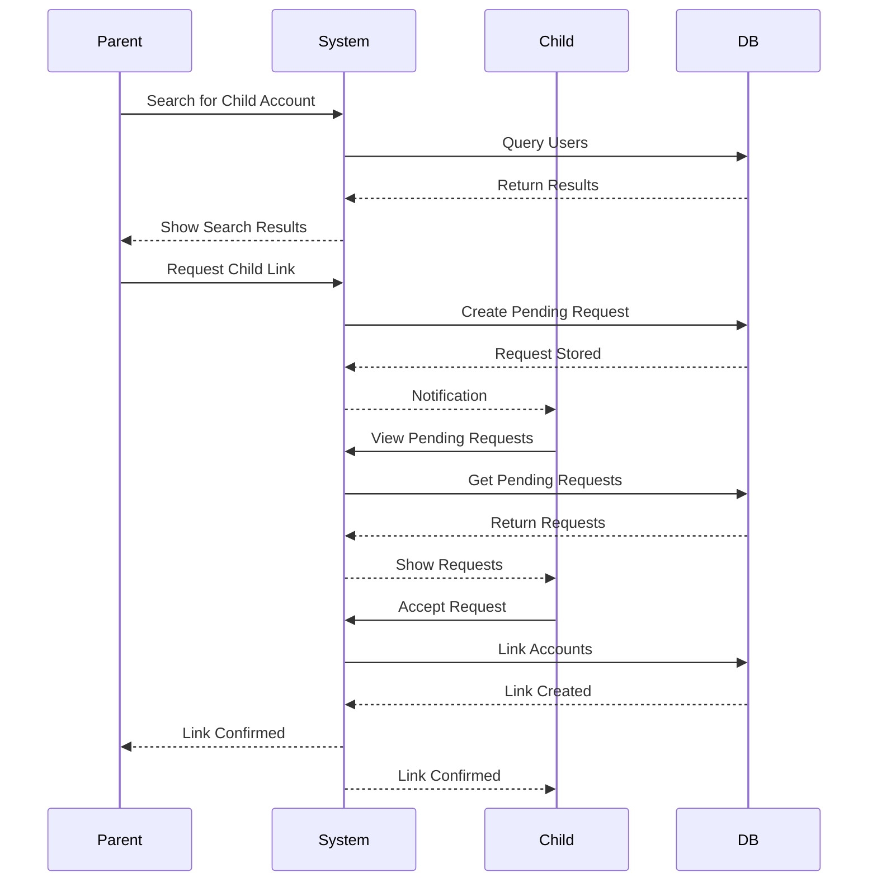
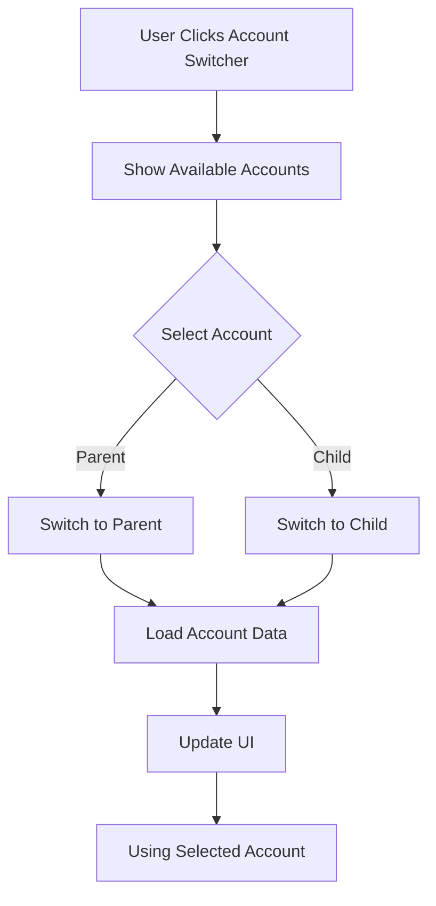

# Multi-Account Management Guide

**Estimated time:** 25 minutes  
**Difficulty:** Intermediate  
**Last updated:** 2026-01-02

Complete guide to managing multiple Nostr accounts with parent/child relationships in SmartFlowSocial.

---

## Table of Contents

- [Overview](#overview)
- [Understanding Parent/Child Accounts](#understanding-parentchild-accounts)
- [Setting Up Parent/Child Relationships](#setting-up-parentchild-relationships)
- [Account Switching](#account-switching)
- [Managing Child Accounts](#managing-child-accounts)
- [Permissions and Access](#permissions-and-access)
- [Unlinking Accounts](#unlinking-accounts)
- [Best Practices](#best-practices)

---

## Overview

SmartFlowSocial supports **parent/child account relationships**, allowing you to:

- **Manage multiple accounts** from one interface
- **Switch between accounts** seamlessly
- **Control child account access** and permissions
- **Share features** between linked accounts
- **Organize accounts** hierarchically

### Use Cases

- **Business accounts** - Manage company and personal accounts
- **Brand accounts** - Manage multiple brand identities
- **Team management** - Parent manages child accounts
- **Account delegation** - Grant access to team members

---

## Understanding Parent/Child Accounts

### Parent Account

**What it is:**

- Main account that manages child accounts
- Can have multiple child accounts
- Controls child account access
- Requires **Premium or Founder** plan

**Capabilities:**

- Search for accounts
- Request child links
- Manage child accounts
- Switch to child accounts
- Unlink child accounts

### Child Account

**What it is:**

- Account linked to a parent
- Can be managed by parent
- Inherits some parent features
- Can unlink from parent

**Capabilities:**

- Access parent's features (if granted)
- Switch back to parent account
- Unlink from parent
- Cannot manage other child accounts

---

## Setting Up Parent/Child Relationships

### Multi-Account Setup Process

### Account Switching Flow

### Prerequisites

**For Parent Account:**

- **Premium or Founder** subscription required
- Account must not be a child account

**For Child Account:**

- Account must exist in SmartFlowSocial
- Account must not already be linked
- Account must accept parent request

### Step 1: Search for Child Account

1. Go to **Settings** → **Accounts**
2. In the search box, enter:

   - Account name
   - Profile display name
   - npub (public key)

3. **Search results appear:**
   - Shows matching accounts
   - Displays profile information
   - Shows account status

### Step 2: Request Child Link

1. **Find the account** in search results
2. **Click "Request Link"** on the account
3. **Request is sent** to child account
4. **Status shows as "Pending"**

### Step 3: Accept Request (Child Account)

1. **Child account receives request:**

   - Notification in Settings
   - Shows in "Pending Requests" section

2. **Accept or reject:**

   - Click **"Accept"** to link accounts
   - Click **"Reject"** to decline
   - Request expires if not responded to

3. **After acceptance:**
   - Accounts are linked
   - Child can switch to parent
   - Parent can manage child

---

## Account Switching

### Switching to Child Account (Parent)

1. **Click account switcher** in navigation
2. **Select child account** from list
3. **Confirm switch** if prompted
4. **You're now using child account**

### Switching to Parent Account (Child)

1. **Click account switcher** in navigation
2. **Select parent account** from list
3. **Confirm switch** if prompted
4. **You're now using parent account**

### Account Switcher Location

**In Navigation:**

- Appears in header/navigation bar
- Shows current account
- Dropdown shows available accounts

**Visual Indicator:**

- Current account highlighted
- Parent/child relationship shown
- Account profile pictures displayed

---

## Managing Child Accounts

### View Child Accounts (Parent)

1. Go to **Settings** → **Accounts**
2. View **"Confirmed Children"** section
3. See all linked child accounts:
   - Account name
   - Profile information
   - Link status

### Pending Requests (Parent)

1. View **"Pending Children"** section
2. See accounts with pending requests
3. **Cancel request** if needed:
   - Click "Cancel Request"
   - Request is removed

### Unlink Child Account (Parent)

1. Go to **Settings** → **Accounts**
2. Find child account in list
3. Click **"Unlink"**
4. Confirm unlinking
5. Child account is unlinked

**Effects:**

- Child account loses parent features
- Child account returns to free plan
- Relationship is removed

---

## Permissions and Access

### Parent Account Permissions

**Can do:**

- Search for accounts
- Request child links
- Manage child accounts
- Switch to child accounts
- Unlink child accounts
- Cancel pending requests

**Cannot do:**

- Link to another parent (if already a child)
- Manage accounts if not Premium/Founder

### Child Account Permissions

**Can do:**

- Accept/reject parent requests
- Switch to parent account
- Unlink from parent
- Use parent's features (if granted)

**Cannot do:**

- Search for accounts
- Request child links
- Manage other child accounts
- Link to multiple parents

### Feature Access

**Child accounts inherit:**

- Parent's subscription features (if granted)
- Access to parent's queues
- Some parent settings

**Child accounts maintain:**

- Own posts and content
- Own settings (some)
- Own queues

---

## Unlinking Accounts

### Unlink from Parent (Child Account)

1. Go to **Settings** → **Accounts**
2. View parent account information
3. Click **"Unlink from Parent"**
4. Confirm unlinking
5. Account is unlinked

**Effects:**

- Relationship removed
- Account returns to free plan
- Loses parent features
- Can link to new parent

### Unlink Child (Parent Account)

1. Go to **Settings** → **Accounts**
2. Find child account
3. Click **"Unlink Child"**
4. Confirm unlinking
5. Child is unlinked

**Effects:**

- Relationship removed
- Child returns to free plan
- Child loses parent features
- Can link to new parent

---

## Best Practices

### Account Organization

1. **Clear naming:**

   - Use descriptive account names
   - Distinguish parent from children
   - Organize by purpose

2. **Limit child accounts:**

   - Only link necessary accounts
   - Keep relationships clear
   - Avoid over-complication

3. **Document relationships:**
   - Note which accounts are linked
   - Understand permissions
   - Keep track of access

### Security

1. **Trust relationships:**

   - Only link trusted accounts
   - Verify account ownership
   - Monitor linked accounts

2. **Access control:**

   - Review child account access
   - Remove unnecessary links
   - Update permissions as needed

3. **Account switching:**
   - Verify you're on correct account
   - Check account before posting
   - Use account switcher carefully

### Workflow

1. **Parent workflow:**

   - Search for child account
   - Request link
   - Wait for acceptance
   - Manage child accounts
   - Switch when needed

2. **Child workflow:**
   - Receive parent request
   - Review parent account
   - Accept if appropriate
   - Switch to parent when needed
   - Unlink if necessary

---

## Troubleshooting

### Cannot Search for Accounts

**Possible causes:**

- Not on Premium/Founder plan
- Account is a child account
- Search feature unavailable

**Solutions:**

- Upgrade to Premium/Founder
- Use parent account for search
- Check subscription status

### Request Not Showing

**Possible causes:**

- Request not sent
- Request expired
- Account already linked

**Solutions:**

- Resend request
- Check account status
- Verify account is available

### Cannot Switch Accounts

**Possible causes:**

- Account not linked
- Relationship removed
- Access revoked

**Solutions:**

- Verify account relationship
- Check account status
- Re-link if needed

---

## Related Documentation

- [Settings Guide](./settings.md) - Account settings
- [Payments Guide](./payments.md) - Subscription requirements
- [Posting Guide](./posting.md) - Posting from different accounts

---

**Next:** [Settings Guide](./settings.md) → Complete settings configuration
