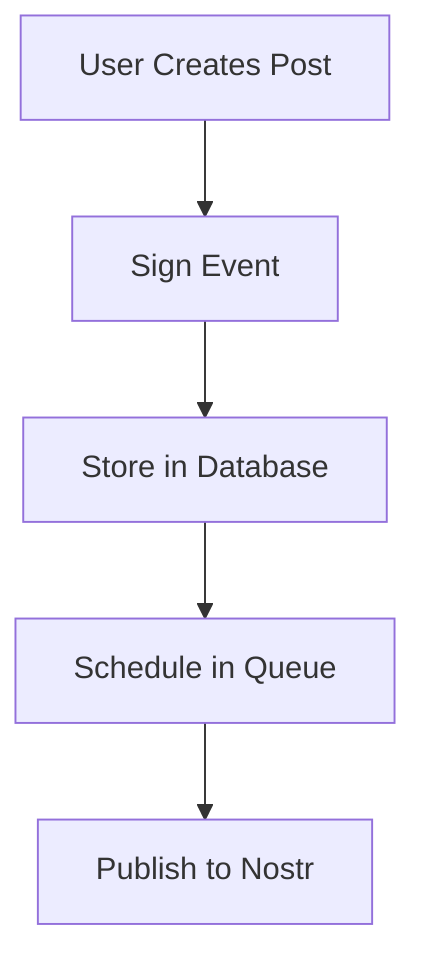
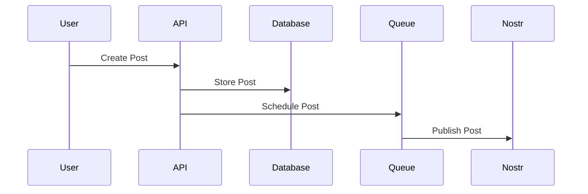

# Visual Aids Guide

**Last updated:** 2026-01-02

Guide for adding visual aids to documentation, including screenshots, diagrams, and flowcharts.

---

## Overview

Visual aids enhance documentation by:

- Making concepts easier to understand
- Showing UI elements and workflows
- Illustrating relationships and processes
- Improving user experience

---

## Types of Visual Aids

### Screenshots

**When to use:**

- UI features and interfaces
- Step-by-step tutorials
- Error messages and dialogs
- Configuration screens

**Best practices:**

- Use high-quality screenshots
- Highlight relevant areas
- Keep file sizes reasonable
- Use consistent styling

**Example:**

```markdown

_The post creation interface with all options visible_
```

### Diagrams

**When to use:**

- System architecture
- Data flow
- Component relationships
- Process flows

**Tools:**

- Mermaid (markdown-based)
- PlantUML
- Draw.io
- Excalidraw

**Example (Mermaid):**

````markdown

````

````

### Flowcharts

**When to use:**
- Decision trees
- Workflows
- Process steps
- Conditional logic

**Example:**
```markdown
```mermaid
flowchart TD
    Start[Start] --> Check{User Authenticated?}
    Check -->|Yes| Allow[Allow Access]
    Check -->|No| Redirect[Redirect to Login]
    Allow --> End[End]
    Redirect --> End
````

````

### Comparison Tables

**When to use:**
- Feature comparisons
- Plan differences
- Tool comparisons
- Before/after comparisons

**Example:**
```markdown
| Feature | Free Plan | Premium Plan |
|---------|-----------|--------------|
| Posts per day | 10 | Unlimited |
| Queues | 1 | 5 |
| Templates | ❌ | ✅ |
````

---

## Adding Screenshots

### Preparation

1. **Capture screenshot:**

   - Use browser dev tools
   - Crop to relevant area
   - Ensure high resolution

2. **Optimize image:**

   - Compress if needed
   - Use appropriate format (PNG for UI, JPG for photos)
   - Keep file size reasonable

3. **Name file:**
   - Use descriptive names
   - Follow naming convention
   - Store in appropriate directory

### Directory Structure

```
docs/
  images/
    screenshots/
      ui/
      tutorials/
      errors/
    diagrams/
      architecture/
      workflows/
```

### Markdown Syntax

```markdown

_Caption explaining the screenshot_
```

---

## Creating Diagrams

### Mermaid Diagrams

**Supported in many markdown renderers:**

````markdown

````

````

### Architecture Diagrams

**Example:**
```markdown
```mermaid
graph TB
    subgraph "Frontend"
        A[React App]
        B[Nostr Extension]
    end
    subgraph "Backend"
        C[Remix Server]
        D[PostgreSQL]
        E[Redis]
    end
    subgraph "External"
        F[Nostr Relays]
    end
    A --> C
    B --> A
    C --> D
    C --> E
    C --> F
````

````

---

## Best Practices

### Screenshots

1. **Consistency:**
   - Use same browser/theme
   - Consistent window size
   - Similar styling

2. **Clarity:**
   - Highlight important areas
   - Add annotations if needed
   - Use arrows or callouts

3. **Accessibility:**
   - Add alt text
   - Use descriptive captions
   - Ensure readable text

### Diagrams

1. **Simplicity:**
   - Keep diagrams simple
   - Focus on key concepts
   - Avoid clutter

2. **Clarity:**
   - Use clear labels
   - Consistent colors
   - Logical flow

3. **Maintenance:**
   - Keep diagrams updated
   - Version control diagrams
   - Document diagram tools

---

## Tools and Resources

### Screenshot Tools

- **Browser DevTools:** Built-in screenshot
- **Snipping Tool:** Windows built-in
- **Grab:** macOS built-in
- **Flameshot:** Linux screenshot tool

### Diagram Tools

- **Mermaid:** Markdown-based diagrams
- **Draw.io:** Free diagram editor
- **Excalidraw:** Hand-drawn style diagrams
- **PlantUML:** Text-based UML diagrams

### Image Optimization

- **TinyPNG:** Compress PNG images
- **ImageOptim:** Optimize images
- **Squoosh:** Web-based image optimizer

---

## Implementation Checklist

### For New Documentation

- [ ] Identify where visual aids would help
- [ ] Capture screenshots if needed
- [ ] Create diagrams for complex concepts
- [ ] Add comparison tables where useful
- [ ] Optimize all images
- [ ] Add alt text and captions

### For Existing Documentation

- [ ] Review for missing visual aids
- [ ] Add screenshots to tutorials
- [ ] Create diagrams for architecture
- [ ] Add flowcharts for processes
- [ ] Update outdated images

---

## Examples

### Screenshot Example

```markdown
## Creating a Post

1. Navigate to the New Post page
2. Enter your content


*The new post interface showing all available options*

3. Click "Post Now" or "Schedule"
````

### Diagram Example

````markdown
## System Architecture

The following diagram shows the overall system architecture:

```mermaid
graph LR
    A[User] --> B[Frontend]
    B --> C[Backend]
    C --> D[Database]
    C --> E[Queue]
    E --> F[Nostr]
```
````

````

### Comparison Table Example

```markdown
## Plan Comparison

| Feature | Free | Premium | Pro |
|---------|------|---------|-----|
| Posts/day | 10 | 100 | Unlimited |
| Queues | 1 | 3 | 10 |
| Templates | ❌ | ✅ | ✅ |
````

---

## Related Documentation

- [Style Guide](./style-guide.md) - Documentation standards
- [Contributing](./contributing.md) - How to contribute

---

**Note:** Visual aids should enhance, not replace, written documentation. Always provide text alternatives.


