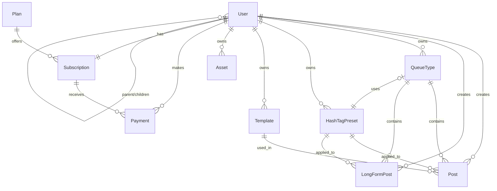

# Database Schema

This document describes the database models used in SmartFlowSocial.

## Entity Relationship Diagram



## Models

### User

The primary user model, representing a Nostr user.

| Field                        | Type           | Description                            |
| ---------------------------- | -------------- | -------------------------------------- |
| `id`                         | String         | Unique identifier (CUID)               |
| `npub`                       | String         | Nostr public key (unique)              |
| `isEnabled`                  | Boolean        | Account activation status              |
| `timezone`                   | String         | User's timezone (default: "Etc/GMT")   |
| `userRelays`                 | String[]       | List of Nostr relays for publishing    |
| `giveawayBlackListed`        | String[]       | Blocked users for giveaways            |
| `uploadProvider`             | UploadProvider | S3, BLOSSOM_PRIMAL, or BLOSSOM_BLOSSTR |
| `showHashTagsinPosts`        | Boolean        | Auto-append hashtags to posts          |
| `scheduleInterval`           | String[]       | Available posting intervals            |
| `nostrProfile`               | Json           | Cached Nostr profile data              |
| `enableMirrorBlossom`        | Boolean        | Mirror uploads to Blossom              |
| `mirrorUploadUrls`           | String[]       | Blossom mirror URLs                    |
| `encryptedNwc`               | String         | Encrypted NWC connection string        |
| `nwcEnabled`                 | Boolean        | NWC feature enabled                    |
| `mutedList`                  | Json           | Muted users/keywords                   |
| `filterMuted`                | Boolean        | Enable mute filtering                  |
| `hidePostsFromLowTrustUsers` | Boolean        | Trust filter enabled                   |
| `isChild`                    | Boolean        | Is a child/sub-account                 |
| `parentNpub`                 | String         | Parent account's npub                  |
| `pendingParentRequests`      | String[]       | Pending child account requests         |

---

### Post

Represents a short-form Nostr post (note).

| Field             | Type     | Description                                                                      |
| ----------------- | -------- | -------------------------------------------------------------------------------- |
| `id`              | String   | Unique identifier                                                                |
| `nostrEventId`    | String   | Published Nostr event ID                                                         |
| `caption`         | String   | Post caption/description                                                         |
| `content`         | String   | Full post content                                                                |
| `fileUrl`         | String[] | Attached media URLs                                                              |
| `scheduledFor`    | String   | Scheduled timestamp                                                              |
| `postedAt`        | DateTime | Actual post time                                                                 |
| `currentState`    | String   | State machine state (DRAFT, SCHEDULED, PUBLISHING, PUBLISHED, FAILED, CANCELLED) |
| `postType`        | PostType | IMAGE, CAROUSEL, TEXT, VIDEO                                                     |
| `repost`          | Boolean  | Is a repost                                                                      |
| `isQuotedPost`    | Boolean  | Is a quote post                                                                  |
| `isRecyclable`    | Boolean  | Can be recycled/reused                                                           |
| `status`          | Status   | DRAFT, ACTIVE, SCHEDULED, etc.                                                   |
| `signedEvent`     | Json     | Signed Nostr event data                                                          |
| `nostrEvent`      | Json     | Full Nostr event object                                                          |
| `tags`            | String[] | Post tags                                                                        |
| `manual_override` | Boolean  | Override auto-scheduling                                                         |
| `userId`          | String   | Owner user ID                                                                    |
| `queueTypeId`     | String   | Associated queue                                                                 |
| `templateId`      | String   | Template used                                                                    |
| `hashTagPresetId` | String   | Hashtag preset used                                                              |

---

### LongFormPost

Represents a long-form article (NIP-23).

| Field             | Type     | Description                                                                      |
| ----------------- | -------- | -------------------------------------------------------------------------------- |
| `id`              | String   | Unique identifier                                                                |
| `nostrEventId`    | String   | Published Nostr event ID                                                         |
| `title`           | String   | Article title                                                                    |
| `summary`         | String   | Article summary                                                                  |
| `content`         | String   | Full markdown content                                                            |
| `image`           | String   | Cover image URL                                                                  |
| `scheduledFor`    | String   | Scheduled timestamp                                                              |
| `postedAt`        | DateTime | Post time                                                                        |
| `publishedAt`     | DateTime | Publication time                                                                 |
| `currentState`    | String   | State machine state (DRAFT, SCHEDULED, PUBLISHING, PUBLISHED, FAILED, CANCELLED) |
| `status`          | Status   | Current status                                                                   |
| `tags`            | String[] | Article tags                                                                     |
| `signedEvent`     | Json     | Signed Nostr event                                                               |
| `nostrEvent`      | Json     | Full event object                                                                |
| `userId`          | String   | Owner user ID                                                                    |
| `queueTypeId`     | String   | Associated queue                                                                 |
| `hashTagPresetId` | String   | Hashtag preset                                                                   |

---

### QueueType

Represents a posting queue with scheduling rules.

| Field             | Type         | Description               |
| ----------------- | ------------ | ------------------------- |
| `id`              | String       | Unique identifier         |
| `name`            | String       | Queue name                |
| `scheduleType`    | ScheduleType | INTERVAL or FIXED_SLOTS   |
| `scheduleConfig`  | Json         | Scheduling configuration  |
| `isEnabled`       | Boolean      | Queue active status       |
| `color`           | String       | Display color             |
| `description`     | String       | Queue description         |
| `lastPostTime`    | DateTime     | Last post from this queue |
| `isDefault`       | Boolean      | Default queue flag        |
| `userId`          | String       | Owner user ID             |
| `hashTagPresetId` | String       | Default hashtag preset    |

---

### HashTagPreset

Reusable hashtag collections.

| Field         | Type   | Description        |
| ------------- | ------ | ------------------ |
| `id`          | String | Unique identifier  |
| `name`        | String | Preset name        |
| `tags`        | String | Hashtag string     |
| `description` | String | Preset description |
| `userId`      | String | Owner user ID      |

---

### Template

Reusable post templates.

| Field    | Type   | Description       |
| -------- | ------ | ----------------- |
| `id`     | String | Unique identifier |
| `name`   | String | Template name     |
| `userId` | String | Owner user ID     |

---

### Asset

User-uploaded assets (text, images, videos).

| Field       | Type      | Description        |
| ----------- | --------- | ------------------ |
| `id`        | String    | Unique identifier  |
| `title`     | String    | Asset title        |
| `content`   | String    | Text content       |
| `fileUrl`   | String    | File URL           |
| `tags`      | String[]  | Asset tags         |
| `assetType` | AssetType | TEXT, IMAGE, VIDEO |
| `userId`    | String    | Owner user ID      |

---

### Plan

Subscription plan definitions.

| Field                     | Type    | Description                |
| ------------------------- | ------- | -------------------------- |
| `id`                      | String  | Plan identifier            |
| `name`                    | String  | Plan name                  |
| `price`                   | Decimal | Price in USD               |
| `description`             | String  | Plan description           |
| `features`                | Json    | Feature list               |
| `maxPostsPerMonth`        | Int     | Monthly post limit         |
| `maxQueueTypes`           | Int     | Queue limit                |
| `maxTemplates`            | Int     | Template limit             |
| `maxAssets`               | Int     | Asset limit                |
| `maxLongFormPosts`        | Int     | Long-form limit            |
| `isActive`                | Boolean | Plan availability          |
| `enableAdvancedAnalytics` | Boolean | Feature flag               |
| `enableBasicScheduling`   | Boolean | Feature flag               |
| `enableBulkScheduling`    | Boolean | Feature flag               |
| `enableGiveaways`         | Boolean | Feature flag               |
| `enableMultipleQueues`    | Boolean | Feature flag               |
| `enableRepostsAndQuotes`  | Boolean | Feature flag               |
| ...                       | ...     | (additional feature flags) |

---

### Subscription

User subscription records.

| Field                | Type               | Description                      |
| -------------------- | ------------------ | -------------------------------- |
| `id`                 | String             | Unique identifier                |
| `userId`             | String             | User ID (unique)                 |
| `planId`             | String             | Selected plan                    |
| `status`             | SubscriptionStatus | ACTIVE, INACTIVE, CANCELED, etc. |
| `currentPeriodStart` | DateTime           | Billing period start             |
| `currentPeriodEnd`   | DateTime           | Billing period end               |
| `cancelAtPeriodEnd`  | Boolean            | Cancel scheduled                 |
| `startDate`          | DateTime           | Subscription start               |
| `endDate`            | DateTime           | Subscription end                 |
| `lastPaymentDate`    | DateTime           | Last payment                     |
| `nextPaymentDue`     | DateTime           | Next payment due                 |
| `amountSats`         | BigInt             | Amount in satoshis               |
| `amountUsd`          | Decimal            | Amount in USD                    |
| `metadata`           | Json               | Additional data                  |

---

### Payment

Payment transaction records.

| Field            | Type          | Description              |
| ---------------- | ------------- | ------------------------ |
| `id`             | String        | Payment identifier       |
| `userId`         | String        | User ID                  |
| `amount`         | Int           | Amount in satoshis       |
| `amountUsd`      | Decimal       | Amount in USD            |
| `invoice`        | String        | Lightning invoice        |
| `paymentHash`    | String        | Payment hash             |
| `preimage`       | String        | Payment preimage         |
| `status`         | PaymentStatus | PENDING, COMPLETED, etc. |
| `description`    | String        | Payment description      |
| `subscriptionId` | String        | Linked subscription      |
| `expiresAt`      | DateTime      | Invoice expiration       |
| `paidAt`         | DateTime      | Payment time             |
| `paymentMethod`  | String        | Payment method used      |

---

### Auth and session

#### LoginChallenge

Server-issued Nostr login challenge (NIP-XX challenge/verify flow).

| Field        | Type      | Description                 |
| ------------ | --------- | --------------------------- |
| `id`         | String    | Unique identifier (CUID)    |
| `nonce`      | String    | Challenge nonce             |
| `purpose`    | String    | Challenge purpose           |
| `expiresAt`  | DateTime  | When the challenge expires  |
| `consumedAt` | DateTime? | When the challenge was used |
| `pubkey`     | String?   | Associated pubkey           |
| `createdAt`  | DateTime  | Creation time               |

#### Session

User session for authenticated requests (cookie-based).

| Field       | Type      | Description              |
| ----------- | --------- | ------------------------ |
| `id`        | String    | Unique identifier        |
| `userId`    | String    | User ID                  |
| `pubkey`    | String    | Nostr pubkey             |
| `createdAt` | DateTime  | Creation time            |
| `expiresAt` | DateTime  | Expiration time          |
| `revokedAt` | DateTime? | When session was revoked |

---

### Engagement

#### EngagementItemState

Tracks which engagement feed items (replies, mentions) the user has handled.

| Field            | Type     | Description                   |
| ---------------- | -------- | ----------------------------- |
| `id`             | String   | Unique identifier             |
| `userId`         | String   | User ID                       |
| `eventId`        | String   | Nostr event ID                |
| `state`          | Enum     | HANDLED                       |
| `repliedFromApp` | Boolean  | Whether user replied from app |
| `updatedAt`      | DateTime | Last update                   |

Unique on `(userId, eventId)`.

#### EngagementReplyTemplate

Reusable reply templates for the engagement feed.

| Field       | Type     | Description       |
| ----------- | -------- | ----------------- |
| `id`        | String   | Unique identifier |
| `userId`    | String   | User ID           |
| `slug`      | String   | Template slug     |
| `body`      | String   | Template body     |
| `createdAt` | DateTime | Creation time     |

Unique on `(userId, slug)`.

---

### Drafts

#### DraftVersion

Single draft version (content snapshot) for a post or long-form.

| Field            | Type   | Description                 |
| ---------------- | ------ | --------------------------- |
| `id`             | String | Unique identifier           |
| (content fields) | ...    | Snapshot of content at save |

#### DraftGroup

Group of drafts (e.g. thread segments or bulk) shared for editing.

| Field | Type   | Description       |
| ----- | ------ | ----------------- |
| `id`  | String | Unique identifier |

#### DraftGroupVersion

Version snapshot of a draft group.

| Field | Type   | Description       |
| ----- | ------ | ----------------- |
| `id`  | String | Unique identifier |

---

### Giveaways

#### Giveaway

Nostr giveaway: scope, eligibility window, engagement types, winner selection.

| Field               | Type      | Description                                      |
| ------------------- | --------- | ------------------------------------------------ |
| `id`                | String    | Unique identifier                                |
| `userId`            | String    | Owner user ID                                    |
| `name`              | String?   | Optional label                                   |
| `scopeType`         | Enum      | PERIOD, SINGLE_POST, QUEUE, FOLLOWERS, FOLLOWING |
| `scopeReference`    | Json      | e.g. days, postId, queueId                       |
| `eligibilityFrom`   | DateTime? | Eligibility window start                         |
| `eligibilityTo`     | DateTime? | Eligibility window end                           |
| `engagementTypes`   | Json      | REACTION, REPOST, COMMENT, ZAP                   |
| `winnerCount`       | Int       | Total winners (or sum when engagementConfig set) |
| `engagementConfig`  | Json?     | Per-type winner count and sats per winner        |
| `selectionMode`     | Enum      | UNIQUE_USER, WEIGHTED_BY_ENGAGEMENT              |
| `engagementWeights` | Json?     | Weights per engagement type                      |
| `filters`           | Json?     | excludeMuted, minAccountAgeDays, etc.            |
| `status`            | Enum      | DRAFT, PREVIEWED, LOCKED, PAID_OUT, CANCELLED    |
| `lockedAt`          | DateTime? | When giveaway was locked                         |
| `winnerSnapshot`    | Json?     | Locked winner list                               |

#### GiveawayPreset

Reusable giveaway configuration (scope, engagement types, winner count).

| Field               | Type   | Description (same as Giveaway for scope/engagement) |
| ------------------- | ------ | --------------------------------------------------- |
| `id`                | String | Unique identifier                                   |
| `userId`            | String | Owner user ID                                       |
| `name`              | String | Preset name (unique per user)                       |
| `scopeType`         | Enum   | As in Giveaway                                      |
| `scopeReference`    | Json   | As in Giveaway                                      |
| `engagementTypes`   | Json   | As in Giveaway                                      |
| `winnerCount`       | Int    | As in Giveaway                                      |
| `engagementConfig`  | Json?  | As in Giveaway                                      |
| `selectionMode`     | Enum   | As in Giveaway                                      |
| `engagementWeights` | Json?  | As in Giveaway                                      |
| `filters`           | Json?  | As in Giveaway                                      |

---

### Outbox and workers

#### OutboxEvent

Outbox pattern: events to be processed by workers (e.g. publish to relays).

| Field                       | Type   | Description                         |
| --------------------------- | ------ | ----------------------------------- |
| `id`                        | String | Unique identifier                   |
| (payload and status fields) | ...    | Event payload and processing status |

#### PostStateTransition

Audit trail of post state machine transitions.

| Field                      | Type   | Description        |
| -------------------------- | ------ | ------------------ |
| `id`                       | String | Unique identifier  |
| `postId`                   | String | Post ID            |
| (from/to state, timestamp) | ...    | Transition details |

#### LongFormPostStateTransition

Audit trail of long-form post state transitions.

| Field            | Type   | Description       |
| ---------------- | ------ | ----------------- |
| `id`             | String | Unique identifier |
| `longFormPostId` | String | Long-form post ID |

#### PublishRelayAck

Relay acknowledgement for a publish attempt (per-relay status).

| Field        | Type      | Description       |
| ------------ | --------- | ----------------- |
| `id`         | String    | Unique identifier |
| `relayUrl`   | String    | Relay URL         |
| `status`     | String    | Ack status        |
| `receivedAt` | DateTime? | When ack received |

#### DeadLetterJob

Failed job record for debugging (e.g. publish failures).

| Field                   | Type   | Description        |
| ----------------------- | ------ | ------------------ |
| `id`                    | String | Unique identifier  |
| (job payload and error) | ...    | Failed job details |

---

### Analytics and reads

#### ScheduledPostRead

Read-model: scheduled posts (for calendar/queue views).

| Field                                 | Type | Description         |
| ------------------------------------- | ---- | ------------------- |
| (denormalized post + schedule fields) | ...  | Optimized for reads |

#### PublishedPostRead

Read-model: published posts (for published feed).

| Field                                | Type | Description         |
| ------------------------------------ | ---- | ------------------- |
| (denormalized post + publish fields) | ...  | Optimized for reads |

#### PostAnalyticsDaily

Daily aggregated analytics per post (engagement counts).

| Field                  | Type | Description        |
| ---------------------- | ---- | ------------------ |
| (postId, date, counts) | ...  | Aggregated metrics |

---

### Push

#### PushSubscription

Web Push subscription for browser notifications.

| Field               | Type   | Description        |
| ------------------- | ------ | ------------------ |
| `id`                | String | Unique identifier  |
| `userId`            | String | User ID            |
| `endpoint`          | String | Push endpoint URL  |
| (keys and metadata) | ...    | p256dh, auth, etc. |

---

### Media and Blossom

#### Media

Logical media entity (can have multiple assets/variants).

| Field    | Type   | Description       |
| -------- | ------ | ----------------- |
| `id`     | String | Unique identifier |
| `userId` | String | Owner user ID     |

#### MediaAsset

Concrete asset (file) belonging to a Media entity.

| Field                       | Type   | Description       |
| --------------------------- | ------ | ----------------- |
| `id`                        | String | Unique identifier |
| `mediaId`                   | String | Parent Media ID   |
| (url, size, mimeType, etc.) | ...    | Asset metadata    |

#### MediaVariant

Variant of a media asset (e.g. resized image).

| Field                        | Type   | Description       |
| ---------------------------- | ------ | ----------------- |
| `id`                         | String | Unique identifier |
| (assetId, variant type, url) | ...    | Variant metadata  |

#### BlossomReservationBatch

Batch of Blossom upload reservations (quota-safe uploads).

| Field | Type   | Description       |
| ----- | ------ | ----------------- |
| `id`  | String | Unique identifier |

#### BlossomReservationItem

Single item in a Blossom reservation batch.

| Field     | Type   | Description       |
| --------- | ------ | ----------------- |
| `id`      | String | Unique identifier |
| `batchId` | String | Parent batch ID   |

#### BlossomCommit

Committed Blossom upload (after successful upload).

| Field | Type   | Description       |
| ----- | ------ | ----------------- |
| `id`  | String | Unique identifier |

#### BlossomUploadUsagePeriod

Usage period for Blossom upload quota (per user/plan).

| Field | Type   | Description       |
| ----- | ------ | ----------------- |
| `id`  | String | Unique identifier |

---

### Referrals

#### Referral

Referral code or link (user refers others).

| Field    | Type   | Description       |
| -------- | ------ | ----------------- |
| `id`     | String | Unique identifier |
| `userId` | String | Referrer user ID  |

#### ReferralEarning

Earning record when a referred user converts.

| Field        | Type   | Description       |
| ------------ | ------ | ----------------- |
| `id`         | String | Unique identifier |
| `referralId` | String | Referral ID       |

#### ReferrerPayoutConfig

Configuration for payouts to referrers.

| Field | Type   | Description       |
| ----- | ------ | ----------------- |
| `id`  | String | Unique identifier |

---

## Enums

### PostType

- `IMAGE` - Single image post
- `CAROUSEL` - Multiple images
- `TEXT` - Text-only post
- `VIDEO` - Video post

### AssetType

- `TEXT` - Text snippet
- `IMAGE` - Image file
- `VIDEO` - Video file

### ScheduleType

- `INTERVAL` - Post every X hours
- `FIXED_SLOTS` - Post at specific times

### Status

- `DRAFT` - Not ready to post
- `ACTIVE` - Ready to be scheduled
- `SCHEDULED` - In the queue
- `PAUSED` - Temporarily paused
- `POSTED` - Successfully published
- `FAILED` - Publication failed

### UploadProvider

- `S3` - Amazon S3 compatible
- `BLOSSOM_PRIMAL` - Primal Blossom
- `BLOSSOM_BLOSSTR` - Blosstr service

### PaymentStatus

- `PENDING` - Awaiting payment
- `COMPLETED` - Payment received
- `FAILED` - Payment failed
- `EXPIRED` - Invoice expired
- `CANCELED` - Payment canceled

### SubscriptionStatus

- `ACTIVE` - Currently active
- `CANCELED` - Subscription canceled
- `PAST_DUE` - Payment overdue
- `UNPAID` - Needs payment
- `TRIALING` - Trial period
- `INACTIVE` - Not active

---

## Database Operations

### Migrations

```bash
# Create a new migration
pnpm exec prisma migrate dev --name migration_name

# Apply migrations
pnpm exec prisma migrate deploy

# Reset database (development only)
pnpm exec prisma migrate reset
```

### Seeding

```bash
# Run database seed
pnpm db:seed
```

The seed file is located at `prisma/seed.ts` and populates initial plan data.

### Prisma Studio

```bash
# Open Prisma Studio for database exploration
pnpm exec prisma studio
```
