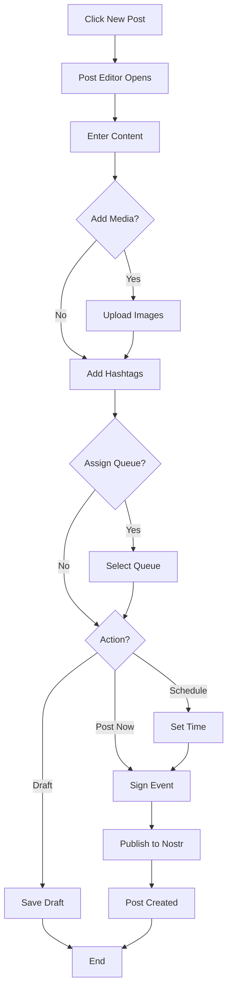

# Creating Your First Post

**Estimated time:** 10 minutes  
**Difficulty:** Beginner  
**Last updated:** 2026-01-02

Step-by-step tutorial to create and publish your first post on SmartFlowSocial.

---

## Prerequisites

Before starting, make sure you have:

- ✅ Account created and logged in
- ✅ Nostr extension installed (e.g., Alby, nos2x)
- ✅ Extension connected to your account
- ✅ Basic understanding of Nostr

---

## Step 1: Navigate to New Post

1. **Log in** to SmartFlowSocial
2. **Click "New Post"** in the navigation menu
   - Or go to `/dashboard/newpost`
3. **Post creation page** opens

### Post Creation Process



---

## Step 2: Write Your Content

1. **Click in the text area**
2. **Type your post content:**
   ```
   Hello Nostr! 👋
   
   Just getting started with SmartFlowSocial. Excited to share content on the decentralized web!
   
   #nostr #bitcoin #lightning
   ```

**Tips:**
- Keep it simple for your first post
- Add hashtags for discoverability
- Use emojis to add personality

---

## Step 3: Add Hashtags (Optional)

**Option 1: Manual Hashtags**
- Type hashtags directly in your post
- Example: `#nostr #bitcoin #lightning`

**Option 2: Hashtag Preset**
- If you have presets configured:
  - Toggle "Use Hashtag Preset"
  - Select a preset from dropdown
  - Preset tags automatically added

---

## Step 4: Choose Post Type

**For your first post, choose:**

- **Post Now** - Publish immediately
- **Schedule for Later** - Set a future time

**We'll use "Post Now" for this tutorial.**

---

## Step 5: Review and Post

1. **Review your post:**
   - Check spelling and grammar
   - Verify hashtags
   - Ensure content looks good

2. **Click "Post Now"**

3. **Sign with Nostr Extension:**
   - Extension popup appears
   - Review the event details
   - Click "Sign" or "Approve"

4. **Post Published!**
   - Success message appears
   - Post is published to Nostr
   - View on Nostr clients

---

## Step 6: Verify Your Post

1. **Check your Nostr client:**
   - Open your favorite Nostr client
   - Find your profile
   - Your post should appear

2. **Or check SmartFlowSocial:**
   - Go to Dashboard → Posted
   - Your post appears in the list

---

## What You Learned

✅ How to create a text post  
✅ How to add hashtags  
✅ How to publish immediately  
✅ How to sign with Nostr extension  
✅ How to verify your post  

---

## Next Steps

Now that you've created your first post, try:

1. **[Adding Images](./adding-images.md)** - Enhance posts with media
2. **[Scheduling Posts](./scheduling-posts.md)** - Plan content in advance
3. **[Using Hashtag Presets](./using-hashtag-presets.md)** - Organize your tags

---

## Troubleshooting

### Extension Not Working

**Problem:** Nostr extension popup doesn't appear

**Solutions:**
- Check extension is installed and enabled
- Refresh the page
- Try a different browser
- Check extension permissions

### Post Not Appearing

**Problem:** Post created but not visible on Nostr

**Solutions:**
- Check your relays are configured
- Verify post was signed successfully
- Wait a few minutes for propagation
- Check relay status

### Signing Failed

**Problem:** Extension signing fails

**Solutions:**
- Check extension is unlocked
- Verify you have permission to sign
- Try signing again
- Check extension logs

---

## Related Documentation

- [Posting Guide](../../guides/user-guides/posting.md) - Complete posting reference
- [Settings Guide](../../guides/user-guides/settings.md) - Configure your account
- [Quick Start](../../getting-started/quickstart.md) - Get started quickly

---

**Next Tutorial:** [Adding Images to Posts](./adding-images.md) → Enhance your posts with media

